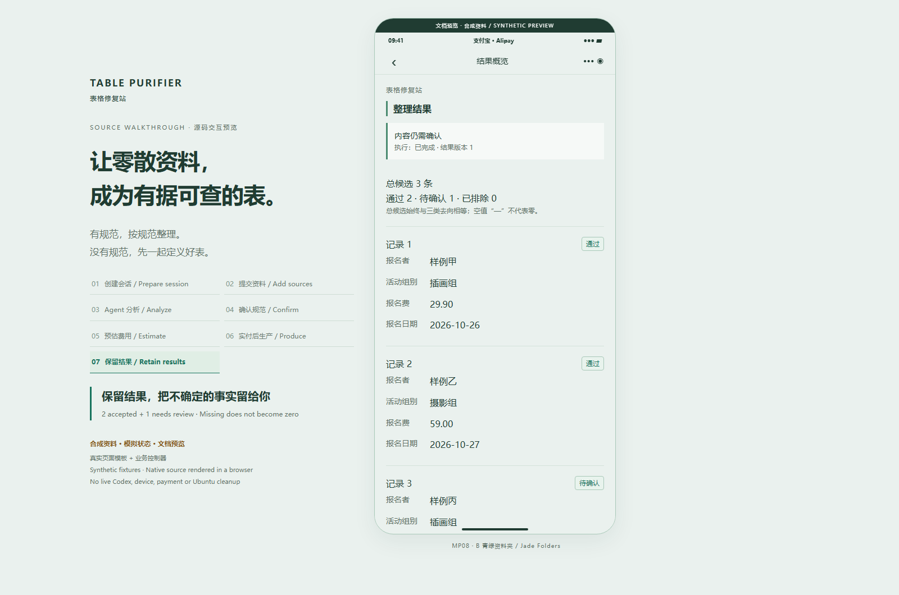
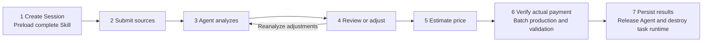
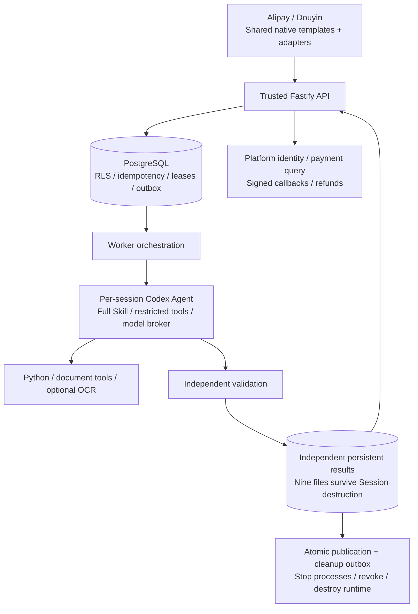

# Table Purifier · 表格修复站

[简体中文](README.md) · [English](README.en.md) · [Documentation](docs/README.md) · [Screenshots & demos](docs/media/README.md) · [Changelog](CHANGELOG.md)

**Turn intentionally submitted text, files and images into structured tables with an agreed schema, traceable evidence and independent validation.** Bring an existing standard, or let a Codex Agent propose one from the material. Review it, receive a quote, pay, and then produce the complete result.

Alipay and Douyin mini programs are the first surfaces, using the selected **B Jade Folders** visual system. The backend wraps the official Codex SDK as an Agent. A trusted application service owns confirmation, pricing, payment verification, independent validation, publication and destruction of the entire task runtime. Web and public API access are later phases.



> Media scope: screenshots, MP4 and GIF are captured from a **browser documentation adapter running the actual native templates, components and controller**. Data, Agent progress, quotes, orders and cleanup states are synthetic fixtures. These are not native-device screenshots, live Codex results, real payments or proof of Ubuntu isolation and cleanup. Demo amounts are not service prices.

## Watch the workflow


- [Full MP4 recording](docs/media/walkthrough.mp4): source-page interactions from session creation to results, issues and evidence; no audio track.
- [36-page screenshot gallery](docs/media/README.md): 18 Alipay pages and 18 Douyin pages.
- [Capture receipt](docs/media/capture-receipt.json) and [media manifest](docs/media/manifest.json): source hashes, file hashes, dimensions and durations.
- [Reproduce the preview](docs/preview/README.md) without model, platform or payment credentials or the business API / Worker.

## Problem and behavior

Registration lists, orders and operational details arrive in inconsistent chat text, images and documents. Users may lack a suitable standard, while a cleaned spreadsheet may still hide conflicts and lose its sources.

Table Purifier asks users to agree on **structure** separately from **facts**. A schema defines what a row represents, field types, required values, units, precision and rules. Submitted sources supply facts. Example rows do not become facts; missing values do not silently become zero. Conflicts, omissions and unverifiable derivations remain review items.

| Mode | User supplies | Agent does | User reviews |
| --- | --- | --- | --- |
| `PROVIDED` | Sources and a standard file or private schema | Understands the schema, analyzes the full submitted scope, proposes mappings and a plan | Schema, scope, rules and plan |
| `DISCOVER` | Sources and an optional description of intended use | Proposes row semantics, fields, types, rules and at most five preview records | Adopts or edits the schema, then confirms the plan |

Broad input is the product direction; current source has explicit format and resource limits below. Uncertain facts require review.

## Mandatory seven-step lifecycle



1. **Prepare the session first.** Assemble and verify the complete Skill text, all references, contracts and tool source, run isolation probes and initialize the Agent. No user goal, text, file or schema is accepted before `READY_FOR_INPUT`.
2. **Accept intentional input.** Choose a mode, submit sources, define scope and consent to processing for this purpose.
3. **Let the Agent analyze.** Codex selects tools, reads the full scope, interprets and cleans data, and proposes a schema and small preview. Python, OCR and document libraries are tools; this is not a fixed parser pipeline.
4. **Require user review.** Edit fields, types, units or rules, or request changes in natural language. Changes invalidate the previous confirmation and unpaid quote.
5. **Quote through the trusted service.** Bind the quote to exact source, schema, plan, Skill and version information. Display and cap the amount in the platform's integer unit. Alipay CNY fen and Douyin diamonds have no implicit conversion.
6. **Produce after verified payment.** The server verifies platform signatures and queries the original order before creating a `PAID` Run. A client checkout return, unknown status or free entitlement cannot authorize paid production. Independent validation checks values, rules, evidence and coverage.
7. **Persist before cleanup.** Copy all nine files into independent storage, read back hashes, commit durably and atomically publish results with a cleanup outbox. Then stop all task processes, revoke access and remove originals, session content, intermediate files, OCR, caches, content logs and the entire task runtime. **Final result files remain available.**

A closed runtime is never resumed. Reworking starts a fresh Session with full preload, a selected parent result and required originals resubmitted, followed by analysis, confirmation and a new estimate. Platform-caused errors may use the original paid entitlement after limited support consent, operator approval and exact plan binding; cumulative processing budgets do not reset. [Lifecycle contract, Chinese](docs/需求深化/07-统一七步流程与Session生命周期.md)

### Pricing, budgets and failures

Current `flat-v1` uses the trusted preflight reading-unit count `N` (1–50): `quote = baseMinor + (N - 1) × unitMinor`. A quote exceeding `maxMinor` is rejected so scope can be adjusted; it is not silently clamped into a cheaper sale. The confirmed quote caps the charge for that scope; changes require reconfirmation. Template values 100 / 10 / 3000 are development examples. Douyin requires its verified SKU's own diamond price policy, without reusing CNY settings.

Defaults are 120 seconds for initialization, 300 for analysis, a cumulative 900 for batch processing, five adjustment rounds and 3600 idle seconds. Limits and failures stop execution and trigger cleanup; payment, fulfillment and refund remain separate states. Query the original order when status is unknown rather than paying again. A processing refund is not an arrival confirmation. Uncertain facts remain review items.

## User interaction

| Surface | Action | Outcome |
| --- | --- | --- |
| Home / sources | Create a session, wait until ready, submit material | Explicit source scope |
| Schema input / recommendations / editor | Bring or edit a schema, fields and rules | Versioned schema and preview |
| Plan and quote | Confirm scope and plan, inspect the capped estimate | Quote bound to the current plan |
| Checkout / order / progress | Pay, query server confirmation, start production | Separate payment, fulfillment, refund and execution states |
| Results / issues / evidence | Review accepted, unresolved and excluded records | Accounted records and retained excerpts |
| Downloads / private schemas | Fetch files; separately consent to saving structure | Nine result files and a reusable private schema |
| Privacy / support | Manage consent, deletion and limited support access | Trackable requests |

Each platform has 18 pages and 32 B components, generated from shared templates and a controller with host adapters. Ordinary completion destroys the runtime and retains results. Explicit privacy deletion can remove selected results. Download grants last five minutes and can be reissued; underlying files do not expire with links. Opening a document, copying a link and confirming a saved copy are recorded separately.

## Nine-file delivery

| File | Purpose |
| --- | --- |
| `standard.xlsx` | Readable schema; `__P07_SCHEMA__` retains complete structure and digest |
| `standard.json` | Machine-readable schema, types, rules and version |
| `result.xlsx` | Readable structured output |
| `accepted.csv` | Accepted records for importing elsewhere |
| `result.json` | Records, field states and dispositions |
| `issues.xlsx` | Unresolved values, conflicts and other issues |
| `provenance.jsonl` | Field evidence, necessary excerpts and locators |
| `validation.json` | Independent validation, coverage and counts |
| `manifest.json` | Artifact names, sizes, SHA-256 and result version |

Candidates must equal accepted + needs review + excluded. Count mismatches, unsupported facts and derivations without reproducible approved rules block automatic acceptance. Zero candidates are not successful delivery. Reading every unit alone does not prove semantic completeness.

## Architecture and stack



| Layer | Current choice | Responsibility and limits |
| --- | --- | --- |
| Mini programs | XML / JavaScript / CSS, esbuild, two generated native projects | Separate host identity, checkout, files and export; **currently no Taro** |
| API / Worker | Node.js `>=22.14 <27`, TypeScript 5.9, Fastify 5 | Trusted orchestration separate from Agent execution |
| Agent | Official `@openai/codex-sdk` **0.164.0** | Pinned SDK / CLI layout; full Skill, tool scope, versions and budgets |
| Database | PostgreSQL; native integration tests use PostgreSQL 18 | Twelve migrations, 66 actual tables, RLS and separate app / Worker / migration roles |
| Documents | ExcelJS, Python 3.10+, pypdf, Pillow, optional Tesseract | Agent-callable tools; unavailable OCR never reports fabricated success |
| Isolation target | **Native Ubuntu 22.04**, Landlock / seccomp / cgroup v2 | Non-root, delegated cgroups, constrained dependency reads and dedicated model broker; no Docker / WSL |
| Verification / media | Vitest, Python unittest, Playwright, FFmpeg | Fixtures and previews remain separate from live acceptance |

**Taro:** shared source is not a Taro implementation. This handoff retains existing native generation. Taro + React + TypeScript remains an architecture evaluation item; no migration was performed. Each host capability still needs verification. [Decision record](docs/implementation-decisions.md)

The trusted Host owns authorization, confirmation, pricing, payment facts, validation, publication and cleanup. The Agent reads, analyzes, suggests schemas, cleans and writes constrained transformation code. It cannot grant payment rights or publish results. Dedicated credentials and a restricted broker replace desktop Codex login, global `auth.json`, personal HOME and merchant secrets.

## Scope and actual readiness

| Area | Current fact |
| --- | --- |
| Formats | TXT, JSON, CSV, XLSX, DOCX, text-extractable PDF, PNG, JPEG; image OCR needs an engine |
| Input budget | Up to 10 sources, 20 MB each / 50 MB total; 50,000 Unicode code points; standard up to 5 MB |
| Processing | Up to 50 reading units, 50 fields, 1,000 candidates and 5 preview records |
| Scanned PDFs | No automatic per-page OCR; supply readable text or supported images |
| Mobile files | Enabled per host/build evidence; arbitrary office-file picking off by default |
| Checked locally | Type checks, builds, unit/native database integration tests, Python tools, static docs and generated mini programs |
| Not run live | Dedicated Codex; platform login/checkout/refunds; four device environments; Ubuntu isolation and process-tree cleanup |
| Default gates | Agent, platforms and commerce off; live evidence must match App, OS, host SDK, build, SKU and configuration digests |
| Later | Web / public API; P1 endpoints explicitly report unimplemented behavior |

Building source is not external integration acceptance. No real credentials, customer data, runtime directory or deployment automation are included. [Source evidence, Chinese](docs/实施/验证与交付记录.md) · [Repository verification](docs/repository-verification.md)

## Install and verify locally

Run at the repository root. These commands do not deploy applications or publish mini programs. Node.js `>=22.14 <27`, npm and Python 3.10+ for document tools are required. Lock files specify exact dependency versions.

```bash
git clone git@github.com:copypasteltd/Table-Purifier.git
cd Table-Purifier
npm ci
npm run typecheck
npm test
npm run build
npm run build:miniapps
```

`npm test` includes real project-local native PostgreSQL integration tests with temporary roles, databases and files. Tests stop their child processes and clean their resources. They do not invoke Docker / WSL or change system PostgreSQL services. Initial dependency and native executable package installation needs network access. Current source checks ran on Windows / Node 22.14.0 / npm 10.9.2. Ubuntu 22.04 is the runtime target.

Prepare Python tools on Ubuntu:

```bash
python3 -m venv runtime/python-tools
runtime/python-tools/bin/python3 -m pip install -r agent/tools/requirements.txt
runtime/python-tools/bin/python3 -m unittest discover -s tests/tools -p test_read_document.py -v
```

On Windows use `runtime/python-tools/Scripts/python.exe`. These commands do not enable the Agent or configure OCR.

### Preview and regenerate media without credentials

```bash
export PLAYWRIGHT_BROWSERS_PATH="$PWD/runtime/tools/playwright"
npx playwright install chromium --only-shell
npm run docs:preview
# Open http://127.0.0.1:4173; close the tab and press Ctrl+C when finished.
```

PowerShell: `$env:PLAYWRIGHT_BROWSERS_PATH = "$PWD/runtime/tools/playwright"`. Browser system libraries must already exist; scripts do not elevate privileges or install OS packages.

```bash
npm run docs:capture
npm run docs:media
npm run docs:verify
```

Media generation requires `ffmpeg` / `ffprobe` on PATH and Pillow in the project Python environment. Capture closes its own pages, contexts, browser and local HTTP server, including on failure. [Preview instructions](docs/preview/README.md)

### Local business development

Dedicated model credentials, App IDs and payment credentials are not ready. Source checks, tests and documentation preview are independent. For controlled local integration, read the [technical guide, Chinese](docs/实施/源码技术说明.md), then prepare project-local `.env`. Optionally use `npm run db:dev` for a loopback-only native database. It creates ignored project-local credentials and connection files, leaves an existing `.env` intact, and stops its child process on Ctrl+C. Run `npm run dev:api` and `npm run dev:worker` in separate terminals afterward.

Missing integrations remain unavailable. Do not enable charges or bypass isolation, payment or evidence gates for a demo. This handoff performs no deployment, container orchestration, platform submission or publication.

## Configuration

| Template | Purpose |
| --- | --- |
| [.env.example](.env.example) | API / Worker databases, dedicated model, platform and pricing flags; real values in `.env` |
| [miniapp/config.example.json](miniapp/config.example.json) | HTTPS API, App aliases, build ID; use `config.local.json` for local overrides and rebuild |
| [config/isolation-profile.example.json](config/isolation-profile.example.json) | Native Ubuntu isolation, cgroup, executable and dependency digests |
| [config/processor-policy.example.json](config/processor-policy.example.json) | Actual processor, region, retention and deletion limitations matching notices |
| [config/douyin-product.example.json](config/douyin-product.example.json) | Platform-approved SKU and signature settings |
| [config/release-evidence](config/release-evidence/README.md) | Exact-build live capability templates |

`P07_PRICE_*` configures prices in the original unit, not an exchange rate. `P07_AGENT_ENABLED`, `P07_ALIPAY_ENABLED`, `P07_DOUYIN_ENABLED` and `P07_COMMERCE_ENABLED` default to `false`. Never commit real keys, `.env`, private settings, real evidence content or runtime data.

## Repository and documentation

```text
src/                  API, domain, Agent, Worker, payment, storage and validation
src/mini-alipay/       Generated Alipay: 18 pages / 32 components
src/mini-douyin/       Generated Douyin: 18 pages / 32 components
miniapp/src/           Shared pages, components, controller and host adapters
agent/skill/           Full Skill, references and contracts
agent/tools/           Document tools and pinned Python requirements
native/                Native Ubuntu isolation launcher C source
migrations/            Twelve SQL migrations
tests/                 Unit, integration and Python tool tests
config/                Credential-free templates
assets/                Requirements, original B design assets, contracts and baselines
docs/实施/             Current implementation and evidence
docs/需求深化/         Requirements, rules, exceptions, tracing and lifecycle
docs/开发/             Frozen development contracts
docs/preview/          Documentation adapters and synthetic fixtures
docs/media/            Screenshots, MP4, GIF and manifests
docs/背景/             Historical snapshots and former root entry points
scripts/               Build, validation, capture and packaging utilities
```

`runtime/`, `node_modules/`, `dist/` and output archives stay out of Git. Two small historical package receipts are retained for frozen checks. Original README and AGENTS bytes are archived without rewriting old manifests. `NOT_IMPLEMENTED` / `NOT_RUN` in frozen documents describes their historical design stage; current facts are in these READMEs, implementation guides and handoff evidence.

[Documentation index](docs/README.md) · [Source index](SOURCE_README.md) · [Contributing](CONTRIBUTING.md) · [Agent instructions](AGENTS.md) · [Bilingual changelog](CHANGELOG.md)

## Future synchronization

For subsequent changes, maintain both READMEs, affected requirements and technical documentation, and bilingual changelog entries. Regenerate affected screenshots, GIFs, recordings and manifests when UI or workflow changes. After checks pass, commit and push to **`git@github.com:copypasteltd/Table-Purifier.git`**, then verify remote HEAD matches the local commit. This standing instruction covers repository updates, not deployment or application publication; see CONTRIBUTING and AGENTS.
