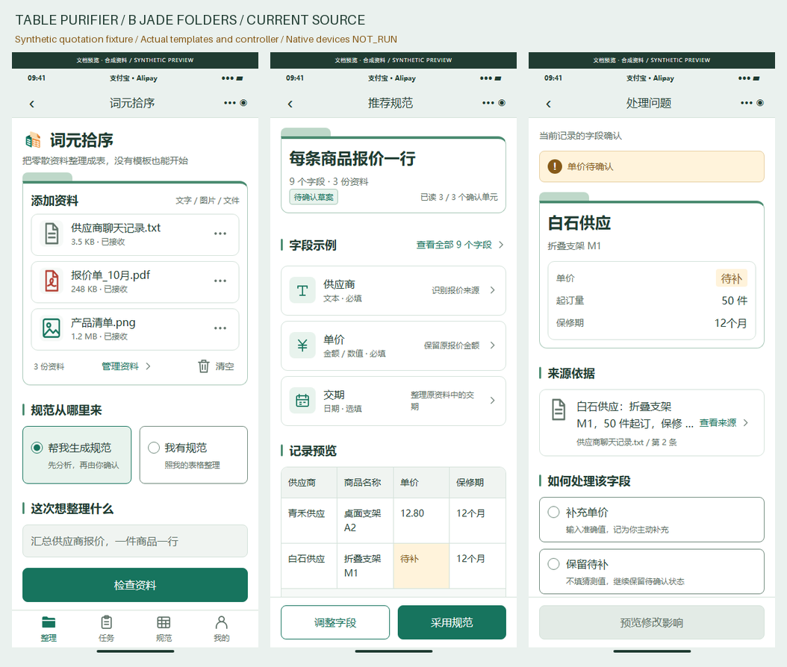
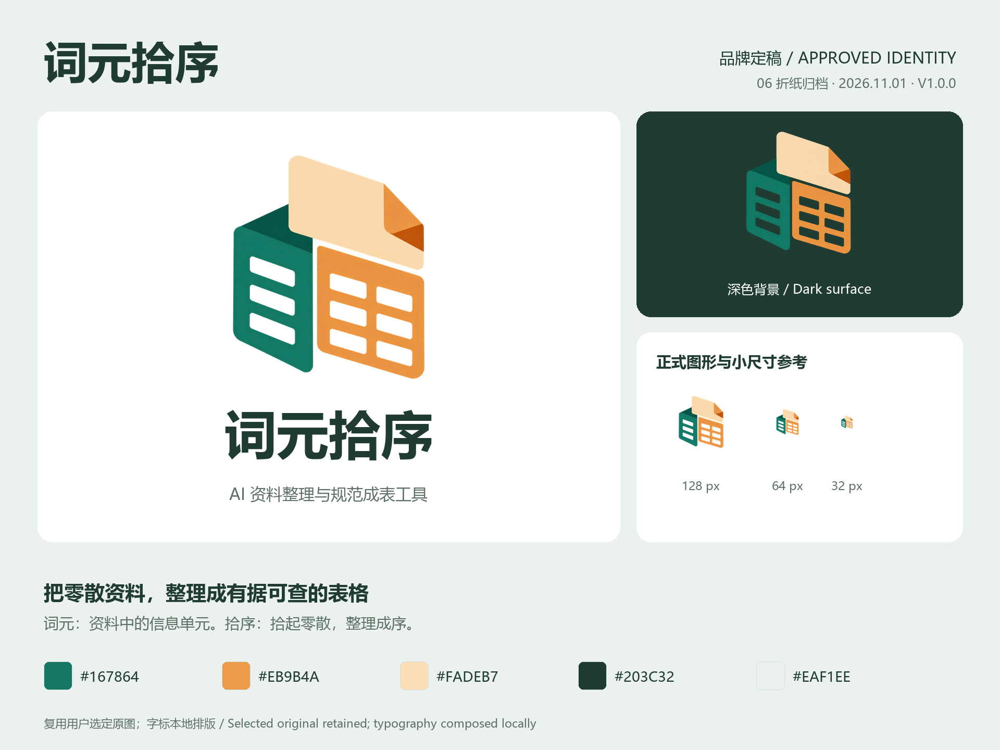
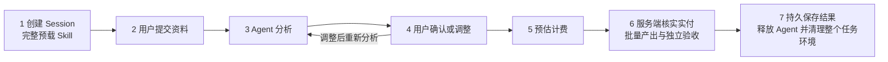
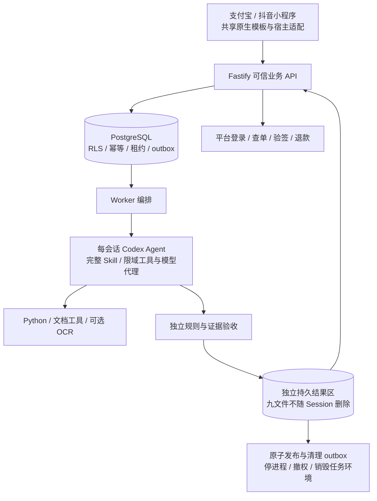

# 词元拾序 · Table Purifier

[简体中文](README.md) · [English](README.en.md) · [文档导航](docs/README.md) · [演示与截图](docs/media/README.md) · [更新说明](CHANGELOG.md)

**把主动提交的文字、文件和图片，整理成有规范、有依据、可验收的表格。** 有标准表时按标准整理；没有标准表时，由 Codex Agent 先分析资料、提出规范，用户确认后再估费、付款和批量产出。

优先提供支付宝、抖音小程序，采用已选定的 **B 青绿资料夹**设计。后端使用官方 Codex SDK 封装 Agent，可信业务服务负责确认、计价、资金、独立验收、发布和整个任务环境的清理。Web / 开放 API 属于后续阶段。



> 展示边界：截图、MP4、GIF 来自实际小程序页面模板、组件和业务控制器的**浏览器文档预览**。资料、Agent、报价、订单和清理状态均为合成夹具；不是支付宝/抖音真机截图，不代表真实模型、支付或 Ubuntu 隔离清理验收。演示金额不是服务定价。

## 品牌定稿 · 词元拾序 / Logo 06

用户已选定名称 **「词元拾序」** 与 **06「折纸归档」Logo**，版本 `P07-BRAND-CIYUANSHIXU-1.0.0`。青绿文档、暖橙表格与浅色折页表达从零散资料到规范交付。当前小程序源码、原生导航标题、文档预览、截图、录屏和 GIF 均采用新品牌；十款候选及冻结 B 原图保留为历史。

[品牌定型与使用规范](docs/brand/README.md) · [正式透明图标、字标、头像和封面](assets/brand/ciyuan-shixu/v1.0.0/README.md) · [十款探索留存](docs/brand/logo-exploration.md)



`Table Purifier` 为沿用的英文项目别名；仓库、工作目录、接口与服务标识不随中文品牌更改。本轮没有重新请求生成图像，也没有更新服务器运行版本。

## 内网 HTTP 部署 · 2026-10-31

已按用户授权原生部署到 **[http://192.168.31.20:18707/](http://192.168.31.20:18707/)**。此入口展示支付宝文档交互预览，[抖音预览](http://192.168.31.20:18707/preview/douyin.html)单独提供。两者均使用合成资料，不连接业务 API；真实 Web 产品仍属后续阶段。

API、Worker、独立 PostgreSQL 14 集群与 Nginx HTTP 入口均作为系统服务运行，配置开机启动。独立安装 Node.js 24.22.2、Python 工具和中英文 OCR；不使用 Docker/WSL，不配置 HTTPS、证书、HSTS 或 HTTPS 跳转。穿透转发目标为 **`192.168.31.20:18707`**。

数据库账户、随机密码及运行密钥按要求明文保存于服务器 **`/root/cfg/table-purifier/credentials.json`**，目录/文件权限为 `0700/0600`。API 与 Worker 配置分别为同目录 `api.env`、`worker.env`；迁移管理员配置不交给常驻服务。仓库不包含这些真实值。

HTTP 健康检查、数据库迁移、非 root 原生隔离及合成任务进程树清理已在服务器核验；专用 Codex、App ID、支付凭据尚未配置，对应开关保持关闭。健康 ready 不表示真实业务全链路通过。[双语部署与维护说明](docs/deployment/README.md) · [部署核验记录](docs/deployment/verification-2026-10-31.json)。

## B 方案还原更新

共享前端已按留存 B 稿统一资料夹、文件/字段卡、表头、字体间距、图标和固定操作栏。两端仍各有 18 页与 32 个组件，结果页可展开全部字段，领取页可展开完整九文件。首页用途与规范模式跨页保留，查看来源返回后保留已选决定。

[原稿 / 修复前 / 修复后对照与逐页说明](docs/实施/B方案前端还原与验收.md) · [164 个布局组合及 14 项交互回归](docs/实施/验证记录/ui-design-fidelity-2026-11-01.json)。覆盖 320/375/390/430 宽度、横屏、文字放大模拟、长内容与错误展示；这些是源码浏览器检查，真机、真实键盘和系统字体缩放仍待验证。

## 演示


- [完整 MP4 录屏](docs/media/walkthrough.mp4)：从建会话到结果、问题和来源依据的页面交互，无音轨。
- [36 页截图索引及联系表](docs/media/README.md)：支付宝 18 页、抖音 18 页。
- [采集记录](docs/media/capture-receipt.json)与[媒体摘要清单](docs/media/manifest.json)：来源文件、SHA-256、尺寸与时长。
- [本地重现演示](docs/preview/README.md)：不需要模型、支付、平台凭据，不启动业务 API / Worker。

## 要解决的问题

报名名单散在聊天文字和文档中；订单、图片、明细的字段写法不一致；用户不知道应该保留哪些列；整理后又无法解释某个值来自哪里。单纯修补 Excel 无法覆盖这些情况。

项目分别确认“**规范是什么**”与“**事实是什么**”：规范定义一行代表什么、字段类型、必填项、单位、精度和规则；资料提供事实。示例行不充当事实，缺失值不自动补成零，冲突、遗漏和无法验证的推导进入待确认项。

| 模式 | 用户提供 | Agent 处理 | 用户确认 |
| --- | --- | --- | --- |
| `PROVIDED` 已有规范 | 原始资料 + 规范文件或私有规范 | 理解规范，分析完整提交范围，提出映射和方案 | 规范、范围、规则和执行方案 |
| `DISCOVER` 没有规范 | 原始资料，可选补充用途 | 提出行对象、字段、类型、规则和最多 5 行小样 | 采用或调整规范，再确认方案 |

“任意资料”是产品输入方向，当前源码有明确格式和预算边界，见下方支持范围。无法确认的内容留待用户处理。

## 必须遵守的七步流程



1. **先准备会话。** 创建独立 Session，校验并装配 Skill 正文、全部 references、合同和工具源码，完成隔离探测和 Agent 初始化。`READY_FOR_INPUT` 前不接收用户目标、正文、文件或规范。
2. **再提交资料。** 选择模式，添加资料、说明用途，明确处理范围并同意资料处理用途。
3. **Agent 自主分析。** Codex 选择文档工具，读取全部已提交范围、分析和清洗资料、提出规范及小样。Python、OCR、文档库是工具，业务不退回固定解析流水线。
4. **用户确认或调整。** 编辑字段、类型、单位和规则，或用文字提出修改。调整使旧确认和未付报价失效，不能沿用过期方案扣款生产。
5. **可信服务估费。** 报价绑定精确资料、规范、方案、Skill 与来源版本，按原平台整数单位展示并封顶。支付宝人民币分、抖音钻石不能隐式换算。
6. **实付后批量产出。** 服务端原平台验签、查单确认付款后才能建立 `PAID` Run。客户端收银返回、未知状态、免费权益不能绕过此条件。独立验收检查真实值、规则、来源依据和覆盖。
7. **先保存，后销毁环境。** 九文件复制到独立结果区，摘要回读、持久提交并原子发布，再停止全部任务进程、撤权，清理原始资料、正文、中间文件、OCR、缓存、日志正文和整个任务运行环境。**最终结果文件继续保留。**

已关闭环境不能复活。再次加工需新建 Session、完整预载、选择父结果并重传必要原件，重新分析、确认和估费。平台自身整理错误经限时售后授权、运营审核和精确方案绑定后，可使用原实付权益纠错；累计处理预算不重置。[完整生命周期](docs/需求深化/07-统一七步流程与Session生命周期.md)

### 计价、预算与异常

当前 `flat-v1` 使用可信预检计量的读取单元数 `N`（1–50）：`报价 = baseMinor + (N - 1) × unitMinor`。超出 `maxMinor` 时拒绝报价，要求调整范围；不会把大任务按较低上限静默成交。一次确认报价就是该范围的实收上限，修改范围需重新确认。模板默认参数为 100 / 10 / 3000，属于开发示例；抖音必须配置经核验商品自己的钻石价格表，不能套用人民币参数。

默认初始化预算 120 秒、分析 300 秒、批量累计 900 秒、调整最多 5 轮、闲置 3600 秒。到限或失败需停止并清理任务，订单、履约、退款分别记录。状态未知先查询原订单，不重复付款；退款处理中不表示已到账。规范或事实不确定时继续待确认，不伪造交付成功。

## 用户怎样操作

| 页面 | 操作 | 得到什么 |
| --- | --- | --- |
| 首页 / 资料清单 | 建会话、等待就绪、提交资料 | 可核对的提交范围 |
| 规范输入 / 推荐规范 / 字段编辑 | 提供或调整规范、字段和规则 | 版本化规范及小样 |
| 预检与报价 | 确认范围与方案，再查看费用 | 绑定当前方案的封顶报价 |
| 原平台收银 / 订单 / 进度 | 付款，查询服务端确认状态，启动批量 | 付款、履约、退款、执行状态 |
| 结果 / 问题 / 来源依据 | 查看通过、待确认、排除记录及证据 | 有明确去向的记录与保留摘录 |
| 结果领取 / 我的规范 | 逐文件领取，单独授权保存规范 | 九文件、可复用私有规范 |
| 隐私 / 售后 | 管理授权、主动删除、限时售后访问授权 | 可查询的删除和售后状态 |

每端 18 页、32 个 B 组件，共享模板与控制器，分别适配宿主 API。普通任务结束销毁运行环境；主动隐私删除可以进一步删除选定结果。领取链接有效期 5 分钟，到期可重新申请；文件不因链接过期被删除。打开文件、复制链接、用户确认保存分别记录。

## 九文件交付

| 文件 | 用途 |
| --- | --- |
| `standard.xlsx` | 可读规范；`__P07_SCHEMA__` 工作表保存完整结构与摘要 |
| `standard.json` | 机器可读规范、类型、规则与版本 |
| `result.xlsx` | 整理后的可读结果 |
| `accepted.csv` | 已通过记录，便于导入 |
| `result.json` | 结构化记录、字段状态与去向 |
| `issues.xlsx` | 待确认、冲突与其他问题 |
| `provenance.jsonl` | 字段来源、必要摘录和定位 |
| `validation.json` | 独立验收、覆盖与统计 |
| `manifest.json` | 文件清单、大小、SHA-256 和结果版本 |

总候选必须等于“通过 + 待确认 + 排除”。记录数不匹配、无可复算规则的推导、无来源事实等会阻止自动通过；零候选不能当作成功交付。完整读取范围不等于语义上已经无遗漏，仍需独立校验和人工确认。

## 技术方案与技术栈



| 层次 | 当前选型 | 职责和边界 |
| --- | --- | --- |
| 小程序 | XML / JavaScript / CSS、esbuild、两端原生工程 | 登录、支付、文件、领取分别适配；**当前未使用 Taro** |
| API / Worker | Node.js `>=22.14 <27`、TypeScript 5.9、Fastify 5 | 可信业务编排与 Agent 分离 |
| Agent | 官方 `@openai/codex-sdk` **0.164.0** | 固定 SDK / CLI 布局，完整 Skill、工具范围、预算和版本校验 |
| 数据库 | PostgreSQL；原生集成测试使用 PostgreSQL 18 | 12 个迁移、66 张实际表、RLS、应用/Worker/迁移独立角色 |
| 文档与导出 | ExcelJS、Python 3.10+、pypdf、Pillow、可选 Tesseract | Agent 可调用工具，不伪造未配置的 OCR 成功 |
| 任务隔离目标 | **Ubuntu 22.04 原生** Landlock / seccomp / cgroup v2 | 非 root、预授权 cgroup、受限依赖读取、专用模型代理；非 Docker / WSL |
| 验证与媒体 | Vitest、Python unittest、Playwright、FFmpeg | 夹具与预览不冒充真实集成验收 |

**Taro 说明：** 共用源码不等于使用 Taro。当前交付保留原生生成方案；Taro + React + TypeScript 是后续架构评估项，本轮整理没有实施迁移。平台能力仍需分别验证，不能由框架名称推定。[技术决策记录](docs/implementation-decisions.md)

Host 负责权限、确认、价格、资金、独立验收、发布和清理；Agent 负责读取、分析、规范建议、清洗和受限成表代码，不能自行授予付款权益或发布结果。模型使用专用凭据和限域代理，不复用桌面 Codex 登录、全局 `auth.json`、个人 HOME 或商户密钥。

## 支持范围和真实状态

| 项目 | 当前事实 |
| --- | --- |
| 格式 | TXT、JSON、CSV、XLSX、DOCX、文本可提取 PDF、PNG、JPEG；图片 OCR 另配引擎 |
| 输入预算 | 最多 10 份资料，单份 20 MB、合计 50 MB；文字 50,000 Unicode 码点；规范文件 5 MB |
| 处理预算 | 最多 50 个读取单元、50 个字段、1,000 条候选；预览最多 5 条 |
| 扫描 PDF | 暂无自动逐页 OCR；需提交可读文本或受支持图片 |
| 文件入口 | 按宿主与构建证据开放；任意办公文件选择默认关闭 |
| 已本地验证 | 类型检查、构建、单元/原生数据库集成测试、Python 工具、文档静态校验、两端源码生成 |
| 已部署验证 | Ubuntu 22.04 HTTP 服务、12 项迁移、原生读取隔离、合成任务进程树及会话清理；见部署记录 |
| 未真实实测 | 专用 Codex 完整业务、平台登录/收银/退款、四种真机环境 |
| 默认开关 | Agent、平台、收费关闭；真实证据必须匹配 App、OS、宿主 SDK、构建、商品、配置摘要 |
| 后续阶段 | Web / 开放 API；P1 接口明确报告未实现 |

能构建不等于外部集成已验收。仓库不含真实凭据、客户资料或运行目录；授权服务器的原生部署脚本单独提供。[源码验证记录](docs/实施/验证与交付记录.md) · [仓库验证](docs/repository-verification.md) · [服务器部署](docs/deployment/README.md)

## 本地安装与检查

在仓库根目录执行；不会部署应用或发布小程序。需要 Node.js `>=22.14 <27`、npm，Python 工具兼容 3.10+。精确依赖以锁文件和 `agent/tools/requirements.txt` 为准。

```bash
git clone git@github.com:copypasteltd/Table-Purifier.git
cd Table-Purifier
npm ci
npm run typecheck
npm test
npm run build
npm run build:miniapps
```

`npm test` 包含真实项目内原生 PostgreSQL 集成测试，创建临时角色、数据库和文件，结束时停止进程并清理本次资源；不调用 Docker / WSL，不改系统 PostgreSQL 服务。首次依赖和本机可执行包安装需网络。当前源码实测环境为 Windows / Node 22.14.0 / npm 10.9.2；Ubuntu 22.04 是目标运行环境。

Ubuntu 中准备项目内 Python 工具解释器：

```bash
python3 -m venv runtime/python-tools
runtime/python-tools/bin/python3 -m pip install -r agent/tools/requirements.txt
runtime/python-tools/bin/python3 -m unittest discover -s tests/tools -p test_read_document.py -v
```

Windows 对应 `runtime/python-tools/Scripts/python.exe`。这些检查不会自行启用 Agent 或配置 OCR。

### 无凭据查看页面与重做媒体

```powershell
$env:PLAYWRIGHT_BROWSERS_PATH = "$PWD/runtime/tools/playwright"
npx playwright install chromium --only-shell
npm run docs:preview
# 打开 http://127.0.0.1:4173；完成后关闭标签并 Ctrl+C 停止本地预览。
```

Ubuntu 使用 `export PLAYWRIGHT_BROWSERS_PATH="$PWD/runtime/tools/playwright"`。浏览器系统库需已就绪；脚本不自动提权安装系统包。

```bash
npm run design:audit
npm run docs:capture
npm run docs:media
npm run docs:verify
```

媒体制作需要 PATH 中的 `ffmpeg`、`ffprobe`，及项目 Python 环境中的 Pillow。采集会自动关闭自己创建的页面、上下文、浏览器和临时 HTTP 服务，包括失败路径。[预览工具说明](docs/preview/README.md)

### 本地业务开发

真实模型、App ID、支付凭据尚未准备，可以先检查和构建源码、运行测试及文档预览。受控本地联调前先读[源码技术说明](docs/实施/源码技术说明.md)，准备项目 `.env`。可选执行 `npm run db:dev`，启动仅监听本机的原生开发数据库，在项目 `runtime` 内生成独立凭据和连接文件，不覆盖已有 `.env`，Ctrl+C 停止子进程。随后独立终端执行 `npm run dev:api`、`npm run dev:worker`。

这不会使未配置的外部功能可用。不得为演示打开收费或绕过隔离、付款、能力证据检查。2026-10-31 授权的内网原生部署见上文；没有容器调度、小程序提审或发布。

## 配置入口

| 文件 | 用途 |
| --- | --- |
| [.env.example](.env.example) | API / Worker 数据库、专用模型、平台和计价开关；真实值放 `.env` |
| [miniapp/config.example.json](miniapp/config.example.json) | HTTPS API、App 别名、构建号；本机覆盖放 `config.local.json` 后重构建 |
| [config/isolation-profile.example.json](config/isolation-profile.example.json) | Ubuntu 原生隔离、cgroup、可执行文件和依赖摘要 |
| [config/processor-policy.example.json](config/processor-policy.example.json) | 实际处理方、地区、保存、删除限制，与告知一致 |
| [config/douyin-product.example.json](config/douyin-product.example.json) | 平台审核商品和签名配置 |
| [config/release-evidence](config/release-evidence/README.md) | 精确构建的真实能力验收模板 |

`P07_PRICE_*` 是原单位计价参数，不是平台间汇率。`P07_AGENT_ENABLED`、`P07_ALIPAY_ENABLED`、`P07_DOUYIN_ENABLED`、`P07_COMMERCE_ENABLED` 默认 `false`。真实密钥、`.env`、私有配置、真实证据正文和运行数据不提交。

## 目录和文档

```text
src/                  API、领域逻辑、Agent、Worker、支付、存储与验收
src/mini-alipay/       支付宝生成工程（18 页 / 32 组件）
src/mini-douyin/       抖音生成工程（18 页 / 32 组件）
miniapp/src/           共享页面、组件、控制器、宿主适配
agent/skill/           实际 Skill、references、合同
agent/tools/           文档工具与 Python 锁定依赖
native/                Ubuntu 原生隔离启动器 C 源码
migrations/            12 个 SQL 迁移
tests/                 单元、集成、Python 工具测试
config/                无真实密钥的配置模板
assets/                需求、B 定型原图、合同和冻结基线
docs/实施/             当前源码、补充接口、验证与交付
docs/需求深化/         需求、规则、异常、追踪、生命周期
docs/开发/             冻结开发合同与技术规格
docs/preview/          文档预览适配器、合成资料
docs/media/            截图、MP4、GIF、摘要清单
docs/背景/             历史快照及更新前的根目录文档
scripts/               构建、校验、媒体采集、源码打包
```

`runtime/`、`node_modules/`、`dist/` 和输出压缩包不入 Git；历史打包仅保留两个必要 JSON 凭据供冻结核验。旧 README、AGENTS 原字节归档，冻结清单不改写。历史文档中的 `NOT_IMPLEMENTED` / `NOT_RUN` 是当时设计阶段状态；当前事实以本 README、实施文档及本轮验证记录为准。

[完整文档导航](docs/README.md) · [源码入口](SOURCE_README.md) · [贡献流程](CONTRIBUTING.md) · [工作约定](AGENTS.md) · [中英更新说明](CHANGELOG.md)

## 后续维护与同步

后续修改同步更新中英 README、相关需求/技术文档和中英更新说明；界面或流程变化时重采受影响截图、GIF、录屏及摘要清单。检查通过后提交并推送到 **`git@github.com:copypasteltd/Table-Purifier.git`**，核对远端提交与本地一致。该持续授权仅涉及本仓库更新，不包含应用部署或发布，执行规则见 CONTRIBUTING 与 AGENTS。
