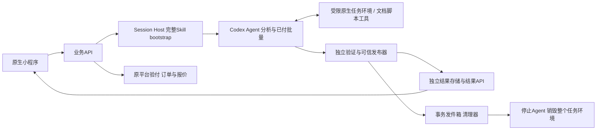

# 系统架构、数据与接口

P07｜业务v3.2｜开发P07-DEV 3.0.0｜2026-10-27｜设计B青绿资料夹1.0.0。设计资料，软件及真实Agent/资金/设备测试未执行。

S1 创建会话并完整预加载Skill → S2 用户提交信息 → S3 Agent分析 → S4 用户确认或调整 → S5 预估计费 → S6 实付后批量产出 → S7 独立保存结果、释放Agent并销毁任务运行环境。

身份会话先完成认证与必要告知；Agent session是新任务的第一个业务资源。初始化不携带客户资料，完整Skill与工具就绪才允许创建关联Task和上传。付费前规范提案关联Task/session；用户确认后合同绑定plan/schema/source/skill，估费与原订单引用该版本。仅实付确认后创建生产Run。

Session、Run、Schema、Quality、Artifact、Payment、Refund、Fulfillment、Operation、Export及Cleanup分别投影。Result READY不等于环境已清，也不等于用户设备已导出。CLOSED不再恢复Agent；结果仍可下载。DB保存最小关联与结果投影；源正文/分析上下文随环境清理。

新增API54/55/56用于先建会话/查加载阶段/关闭清理；API18—20由runs路径改到tasks路径；API03必须ready_agent_session，API09完整付费前分析，API10确认计划，API11之后才估费，API16只接受原实付。56项接口仍为草案，未部署。

文件、路径、权限、hash、owner由服务端核实；Agent无资金、DB、规范采用或持久发布权。原生ACL/受限身份与Codex权限需要真实反例验证，cwd不是租户读隔离。禁止本地虚拟化。

[完整会话/留存合同](需求深化/07-统一七步流程与Session生命周期.md)、[接口目录](../assets/contracts/api-catalog.v3.2.json)、[开发设计](开发/README.md)。
