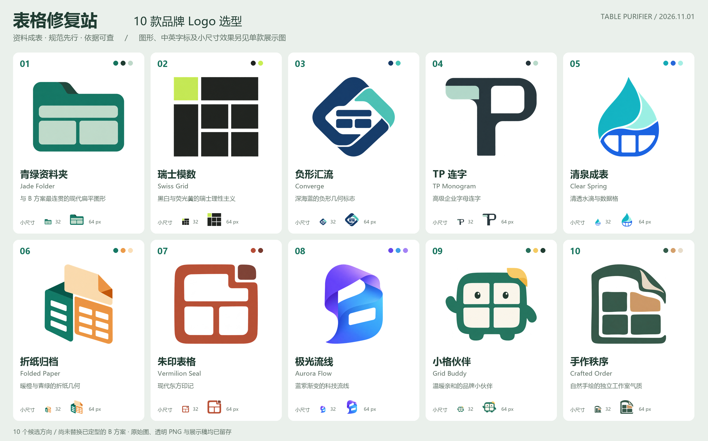

# Logo 选型 · 2026-11-01 / Logo exploration

> 选型已完成：用户定稿「词元拾序」，使用 **06 折纸归档**。本页保留生成与比较过程，以下待选型描述仅属于当时的候选阶段；当前名称、资产和使用规则以[正式品牌规范](README.md)为准。Selection is complete: **词元拾序 / concept 06**. The following exploration is historical; the current identity is documented separately.

[项目中文说明](../../README.md) · [English project guide](../../README.en.md) · [全部素材与提示词](../../assets/brand/logo-exploration/2026-11-01/README.md)

为「表格修复站 / Table Purifier」准备 10 个不同的品牌方向。使用用户指定的 `sub2-image-gen` 技能实际生成，固定请求 `gpt-image-2.5`，没有替换模型或服务。图形原图与后期品牌字排版分别留存，当前等待用户选择。

Ten genuinely generated alternatives for Table Purifier. All image requests used the requested skill and model; typography and presentation sheets were composed afterward. No final identity has been selected or substituted into the product.



## 先看这三款 / Suggested shortlist

| 方向 | 选择理由 | 更适合的定位 |
| --- | --- | --- |
| **01 青绿资料夹 / Jade Folder** | 图形直接表达资料、表头和归档，青绿配色与 B 方案连贯 | 当前小程序、产品入口、最快形成一致的上线物料 |
| **04 TP 连字 / TP Monogram** | 用 T 的表头和 P 的收纳腔形成紧凑字母标，轮廓简洁 | 长期独立品牌、企业页头、合作材料 |
| **09 小格伙伴 / Grid Buddy** | 将表格拟成有表情的小伙伴，保留青绿和暖黄 | 抖音传播、社媒头像、新手引导 |

Shortlist: **01** for continuity with the current product, **04** for a lasting corporate identity, and **09** for an approachable social presence. These are visual judgments, not measured user-study scores.

## 十款方向与使用考虑 / Ten directions

| 编号 | 风格 / Style | 表达重点 | 使用时关注 |
| --- | --- | --- | --- |
| 01 | 青绿资料夹 / Jade Folder | 输入资料成为有表头的规范表 | 文件夹语义直接，适合主产品入口 |
| 02 | 瑞士模数 / Swiss Grid | 黑白网格与荧光黄模块建立秩序 | 更偏技术、理性；色彩适配需单独定型 |
| 03 | 负形汇流 / Converge | 多源路径汇成中间的表格 | 外轮廓独立，内部表格在更小尺寸可再简化 |
| 04 | TP 连字 / TP Monogram | 英文品牌首字母与表格结构 | 首次接触时配中文品牌字更容易理解业务 |
| 05 | 清泉成表 / Clear Spring | 数据清洗与整洁的表格 | 水滴也有清洁用品联想，需用字标明确产品 |
| 06 | 折纸归档 / Folded Paper | 文档折叠、结构化、交付 | 折面和格子较多，小尺寸可后续另做简版 |
| 07 | 朱印表格 / Vermilion Seal | 中文品牌、依据与留痕 | 当前图形偏线框，落到很小尺寸需核对笔画 |
| 08 | 极光流线 / Aurora Flow | 流畅自动化、科技感 | 适合宣传大图；单色版需要重新梳理轮廓 |
| 09 | 小格伙伴 / Grid Buddy | 亲和、协助、低门槛 | 适合用户传播，商务场景可搭配端正字标 |
| 10 | 手作秩序 / Crafted Order | 纸页、格线与有温度的整理 | 更偏内容创作与工作室气质 |

The collection spans a folder symbol, Swiss modular grid, negative-space convergence, TP monogram, data droplet, origami, seal-inspired mark, gradient ribbon, friendly mascot and hand-cut paper graphic. Each can be inspected independently in the asset gallery.

## 留存文件 / Deliverables

- **10 张原始图**：网关实际返回 1254×1254 RGBA，原字节与 SHA-256 留存；请求尺寸仍记录为 1024×1024。
- **60 张透明 PNG**：每款提供 1024、512、256、128、64、32 六种尺寸，统一居中与留白。
- **10 张单款展示图**：1600×1320，中英字标、浅色界面与小程序/头像示意。
- **1 张对比总览**：2600×1620，十款及 32/64 px 效果在同一版面比较。
- **提示词与收据**：记录实际请求、时间、原始摘要、透明度检查、裁边范围及尺寸派生；不包含网关地址、API Key 或字体文件。
- **本地 ZIP**：`output/imagegen/table-purifier-logos-2026-11-01/Table-Purifier-10-Logo-Options-2026-11-01.zip`，包含上述保留素材与说明；输出压缩包按仓库约定不入 Git。

The package contains ten unchanged originals, sixty normalized transparent PNGs, ten presentation sheets, one overview, prompts and sanitized generation receipts. Original dimensions reflect the gateway response rather than silently rewriting it. Font files and credentials are excluded.

全部 PNG 通过文件解码与摘要检查，十款原图都有真正的 Alpha 透明像素。对比图与单款展示经过人工查看；32/64 px 示例仅用于比较，不代表支付宝/抖音真机审核。调色板为设计意图，选定后再统一精确色值、反白、单色和深浅背景规则。

PNG decoding, transparency and digest checks passed. Visual review covered the overview and presentation. Small-size examples are design references rather than native-platform acceptance. Palette swatches describe the intended direction; exact production colors and reverse/monochrome treatments follow selection.

## 与当前项目的关系 / Relationship to the product

当前是候选设计，尚未更换小程序、预览页面或服务器上的品牌。B1.0.0 冻结稿及其摘要保持原字节。交付以位图为主，未创建可编辑 SVG/AI 矢量母版。选定编号后，再围绕该方向制作统一的主标志、横竖组合、单色/反白、安全留白、背景用法及上线封面。

The frozen B design and deployed product assets retain their existing bytes. These are raster candidates; no editable vector master or final rollout is claimed. After one direction is chosen, refine the mark and establish its lockups, clear space, backgrounds and launch materials.

## 重现 / Reproduction

在仓库根目录请求指定单款，显式提供本机技能脚本位置：

```powershell
python -X utf8 scripts/generate-logo-concept.py --id 01 --skill-script 'C:/Users/carzy/.codex/skills/sub2-image-gen/scripts/sub2_image_gen.py'
python -X utf8 scripts/build-logo-exploration.py
npm run docs:verify
```

生成命令会调用图像服务；排版命令只读取已生成素材并派生尺寸。Windows 使用本机 Microsoft YaHei，不分发字体；需要 Pillow。重现提示词能再次请求相同方向，图像生成不承诺逐像素相同。完整原图和摘要用于保留本轮真实结果。

已有同名输出时，生成脚本默认复用文件并退出，不重复请求；确需新图时显式添加 `--force`。Existing output is preserved by default; `--force` explicitly authorizes a replacement request.

The generation command calls the external skill. The composition command uses the already generated images and local Windows typography. Repeating a prompt does not guarantee identical pixels; retained originals and hashes identify this actual generation batch. No browser, Docker, WSL or virtual-machine workflow is used.
