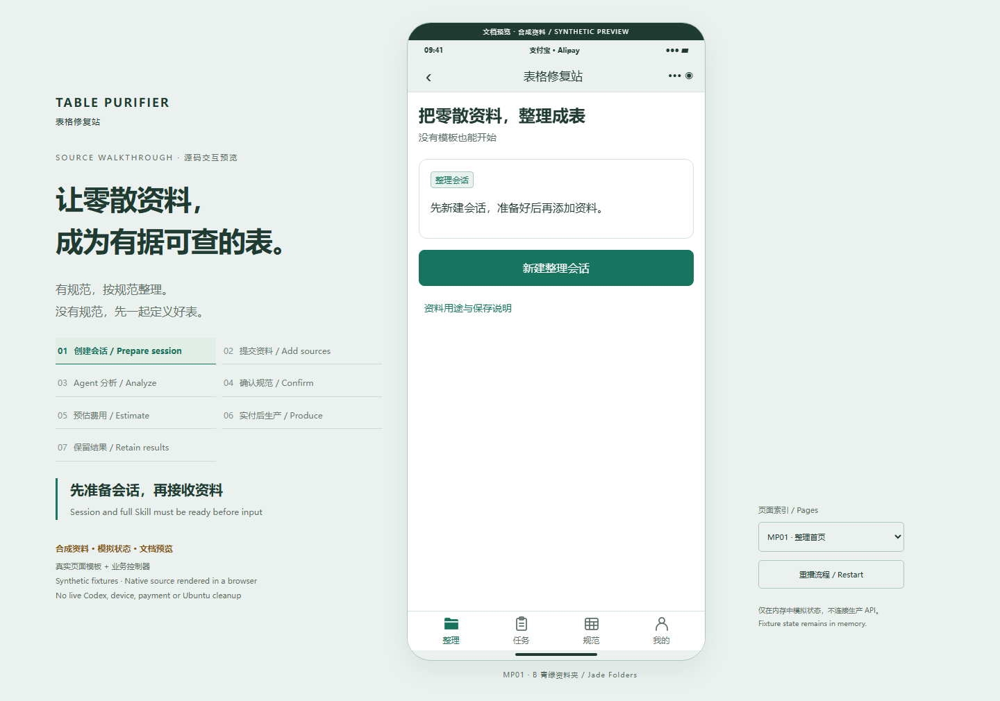

# Ubuntu 22.04 原生 HTTP 部署

[English](README.en.md) · [项目说明](../../README.md) · [部署脚本](../../scripts/deployment) · [部署核验](verification-2026-10-31.json)

本轮由用户于 2026-10-31 明确授权部署到 `192.168.31.20`，安装缺少的依赖，使用高位 HTTP 端口，并将新建的用户、数据库及密码信息明文保存在服务器 `/root/cfg/`。不配置本项目 HTTPS、证书、跳转或 HSTS，不调用 Docker、WSL、虚拟机，不变动其他应用的数据库和端口。

## 访问与交付边界

| 内容 | 地址或位置 |
| --- | --- |
| 局域网入口 | `http://192.168.31.20:18707/` |
| 支付宝交互预览 | `http://192.168.31.20:18707/preview/` |
| 抖音交互预览 | `http://192.168.31.20:18707/preview/douyin.html` |
| 进程存活 | `GET /health/live` |
| 数据库迁移就绪 | `GET /health/ready` |
| 业务接口 | `/v1/p07/*`，保留现有登录及所有权验证 |
| API 内部监听 | `127.0.0.1:18708` |
| 独立 PostgreSQL 14 集群 | `127.0.0.1:18709`，集群名 `14/tablepurifier` |
| 项目源码及构建 | `/opt/table-purifier/app/` |
| 独立 Node 运行时 | `/opt/table-purifier/toolchain/node-v24.22.2-linux-x64/` |
| 独立 Python 工具 | `/opt/table-purifier/app/runtime/python-tools/` |
| 浏览器预览静态文件 | `/opt/table-purifier/site/preview/` |
| 新建凭据及运行配置 | `/root/cfg/table-purifier/` |

根路径跳转到**文档交互预览**。这套预览复用实际小程序模板与控制器，使用合成资料、模拟 Agent、报价和订单；其浏览器网络策略禁止连接业务 API，不处理真实上传或支付。它不是已上线 Web 产品。小程序仍需在各自开发者工具配置 App ID、服务地址及平台能力后构建、真机验收和提审。

API、Worker、数据库的运行与原生隔离探针分别核验。`/health/ready` 只证明数据库连接和全部迁移摘要一致，不能替代模型、支付、宿主 SDK 或真机验收。缺少专用模型和平台凭据时，Agent、支付宝、抖音及收费开关保持关闭，不创建可接收客户资料的 READY 会话。

## 安装构成

主机原有 Node.js 20 不满足项目范围。本项目从 [Node.js 官方发布目录](https://nodejs.org/dist/v24.22.2/)取得独立的 Node.js 24.22.2 二进制，并核对同目录 SHA-256 清单。系统原有 Node、其他服务和数据库集群保留。本项目另使用系统 Python 3.10、GCC、PostgreSQL 14、Nginx、Tesseract 英文/简体中文语言包；Python 库固定于 `agent/tools/requirements.txt`。

初次安装顺序：

1. 检查 OS、磁盘、已有服务与端口；本次 `18707/18708/18709` 均为空闲。
2. 在已获授权的服务器以 root 运行 `scripts/deployment/prerequisites.sh`，安装依赖并创建无登录权限的系统用户 `tablepurifier`。
3. 在本地仓库运行 `npm run check`、`node docs/preview/build.mjs`、`python scripts/deployment/package.py`。压缩包与摘要位于忽略目录 `runtime/deploy/`；包内不含运行数据、真实配置、私钥或凭据。
4. 上传压缩包并核对 SHA-256；以 root 解压到新建的 `/opt/table-purifier/app/`。不要把整个目录递归改属主作为后续更新方式。
5. 创建仅 `tablepurifier` 可写的 `runtime/` 和用于首次安装的 `node_modules/`；将独立 Node 路径加入本次命令的 PATH，保留 `/usr/sbin`。以 `tablepurifier` 执行 `npm ci --omit=dev --no-audit`，忽略个人 npm 配置；安装后把依赖目录改回 root 所有。
6. 创建 `runtime/python-tools/` 虚拟环境并安装固定 requirements。它是 Python 包目录，不涉及虚拟机或容器。
7. 在应用根目录以 root 执行 `python3 scripts/deployment/bootstrap.py`，创建专用数据库集群和凭据、执行十二个迁移、授权运行角色、编译原生隔离启动器、生成带真实摘要的私有配置。
8. 将 `table-purifier-*.service` 和 `tablepurifier.slice` 复制到 `/etc/systemd/system/`；执行 `systemctl daemon-reload`，先启用 `table-purifier-isolation`，再启用 `table-purifier-api` 和 `table-purifier-worker`。使用 `enable --now` 设置开机启动。
9. 将包内 `_site/preview/` 复制到 `/opt/table-purifier/site/preview/`；生成 `douyin.html`，仅把入口脚本由 `ALIPAY.js` 替换为 `DOUYIN.js`。预览及图标只读。
10. 将项目 `nginx.conf` 安装为 `/etc/nginx/conf.d/table-purifier.conf`，`nginx -t` 成功后平滑重载。只在已启用的防火墙上开放 `18707/tcp`；本机原防火墙未启用，不擅自启用或重置。

`bootstrap.py` 会复用已有凭据、配置和数据库，不重置密码或清空数据。若发现部分初始化失败，先查看本地私有配置与集群状态，不删除重建，也不对已有生产应用整目录重新改属主。

## 明文凭据

目录权限为 `0700`，凭据及 `.env` 文件为 `0600`，所有者 root。以 root 登录后查看：

```sh
cat /root/cfg/table-purifier/credentials.json
ls -l /root/cfg/table-purifier/
```

| 文件 | 内容与用途 |
| --- | --- |
| `credentials.json` | 数据库名、地址、端口，`tp_api`、`tp_worker`、`tp_migrator` 用户及明文随机密码，Token/身份密钥、运营 Token 和系统账户说明 |
| `api.env` | API 运行配置及 API 数据库 URL；不含迁移账户 |
| `worker.env` | Worker 运行配置及 Worker 数据库 URL；不含迁移账户 |
| `migration.env` | 迁移管理员连接，仅手动迁移使用，任何常驻服务均不加载 |
| `README.txt` | 服务器本地访问、配置和维护入口 |

运行登录为非超级用户、无 `BYPASSRLS`、非业务 schema 所有者；API 只继承 `p07_app`，Worker 只继承 `p07_worker`。迁移管理员单独拥有本项目专属集群的建角色/迁移能力，不能提供给 API 或 Agent。固定 `p07_control` 为无登录的安全函数角色。PostgreSQL 只允许环回地址及固定数据库/用户名的 SCRAM 认证；系统 `postgres` 仅可通过 OS peer 本地管理。

systemd 由管理进程读取 root 配置后，给无特权服务注入环境变量。Agent 子进程使用单独构造的环境，不继承数据库 URL、商户密钥或个人 Codex 登录。不要将 `/root/cfg/` 复制进项目或 Git、Nginx 静态目录、截图与日志。

## HTTP、穿透与域名

将自己的穿透入口转发到服务器 **`192.168.31.20:18707`**，协议选 HTTP。只需转发这一个入口；`18708` 和 `18709` 只在服务器环回监听。

生产配置明确设置 `P07_ALLOW_HTTP_DEPLOYMENT=true` 和 HTTP `P07_PUBLIC_URL`。API 不发送 HSTS 或 `upgrade-insecure-requests`；本项目 Nginx 配置没有 TLS 监听、证书或 HTTPS 跳转。不变动其他应用已有的 HTTPS 配置。

拿到正式域名后，在 `api.env` 和 `worker.env` 中把 `P07_PUBLIC_URL` 改为实际的 `http://你的域名`（不加内部端口），更新 `credentials.json` 的说明地址，然后重启 API/Worker。应用生成的下载/回调地址使用此值。小程序服务地址需另更新本地构建配置并重新构建；域名登记及真实平台能力仍需要平台侧验收。

## 启停与诊断

以下命令在服务器以 root 执行：

```sh
systemctl status table-purifier-api table-purifier-worker table-purifier-isolation postgresql@14-tablepurifier --no-pager
systemctl restart table-purifier-api table-purifier-worker
systemctl stop table-purifier-api table-purifier-worker
systemctl start table-purifier-api table-purifier-worker
journalctl -u table-purifier-api -u table-purifier-worker -n 80 --no-pager
curl --fail http://127.0.0.1:18707/health/live
curl --fail http://127.0.0.1:18707/health/ready
nginx -t
```

日常重启只操作本项目服务。独立数据库集群是 `postgresql@14-tablepurifier`；不要为本项目重启整个 PostgreSQL 或机器。全停维护时先停止 API/Worker，再操作隔离委托和本项目数据库，避免留下正在处理的任务。

原生隔离探针可在与服务相同的用户、只读文件系统及写路径约束下执行：

```sh
systemd-run --unit=table-purifier-native-probe --wait --collect --pipe \
  -p User=tablepurifier -p Group=tablepurifier -p Slice=tablepurifier.slice \
  -p WorkingDirectory=/opt/table-purifier/app \
  -p EnvironmentFile=/root/cfg/table-purifier/api.env \
  -p ProtectSystem=strict -p ProtectHome=true -p PrivateTmp=true -p NoNewPrivileges=true \
  -p 'ReadWritePaths=/opt/table-purifier/app/runtime /sys/fs/cgroup/tablepurifier.slice/table-purifier-isolation.service' \
  /opt/table-purifier/toolchain/node-v24.22.2-linux-x64/bin/node scripts/deployment/native-probe.mjs
```

探针使用随机合成 canary，检查跨目录读取被拒、控制文件只读、本任务可写、Python 依赖可加载、固定 Codex CLI 能在约束内执行 `--version`，再启动真实父子进程验证整组终止、会话目录完整移除。它不请求模型、支付或处理客户资料。收据在 `runtime/deployment/native-probe.json`。它不替代真实 Codex 从创建会话到付款产出的整条验收。

API、Worker 和隔离委托位于专用 `tablepurifier.slice`。仅该项目公共祖先的 `cgroup.procs` 授权给服务用户，使其可以将新任务移入子 cgroup，不授权系统根或其他应用层级。隔离单元在子组保留轻量常驻进程，避免空的 oneshot cgroup 被 systemd 自动移除；API/Worker 的写权限只覆盖本项目运行目录和已委托的任务层级。

## 部署截图

以下截图直接采集自内网 HTTP 地址，保留页面中的合成资料标识。两端均无脚本错误或缺图，浏览器资源已关闭。它们证明已部署预览能正确加载，不证明真实业务模型或支付通过。



[抖音 HTTP 交互预览截图](screenshots/douyin-http.png)

## 接入专用凭据

在提供专用模型 API Key、模型 ID、实际模型服务地址后，还须准备匹配实际数据处理方的告知配置/数据库版本，再在原生隔离验收通过的前提下配置 Agent。支付宝、抖音需要各自 App ID、商户/签名参数和真实能力证据；收费需要真实支付与退款验收。敏感文件继续保存在 root 配置或项目已忽略的专用配置中，按现有相对路径约束处理。不要使用桌面登录、全局 `auth.json` 或虚假支付作为替代。

不要仅因 HTTP 健康检查为 ready 就打开这些开关。补齐后重启 API/Worker，再验证创建 Session → 全量 Skill → 用户输入 → 分析 → 确认 → 报价 → 实付 → 九文件发布 → 销毁任务环境、保留结果的完整业务流程。

## 更新与备份

后续源码改动仍需同时更新双语说明与 CHANGELOG，检查后提交推送指定仓库。更新部署是另一个动作：先核对当前版本、备份数据库与运行结果，再停止本项目 API/Worker，上传检查过的新代码，保留 `runtime/`、私有配置和 `/root/cfg/`，使用同一个独立 Node 执行锁文件安装和迁移，启动并复查健康、权限及隔离探针。禁止用空目录覆盖运行数据或复制开发机的 `node_modules`。

数据库备份可用专用集群 OS peer 方式执行 `pg_dump -p 18709 -d table_purifier -Fc`，不把密码放在命令行。将数据库、`runtime/results/`、必要的会话运行状态及 `/root/cfg/table-purifier/` 作为同一恢复点保存到仅 root 可读的位置。默认不创建未经要求的外部备份、计划任务或自动更新。

正常业务结束只销毁对应 Session 的完整任务环境，九个结果文件留在独立 `runtime/results/` 中。本次部署不改变这条规则。
