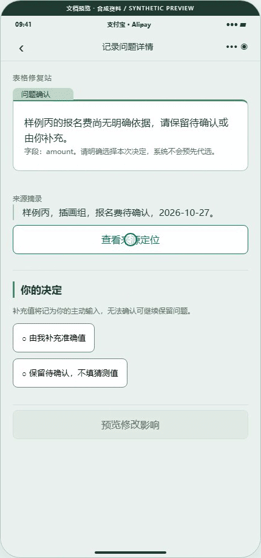
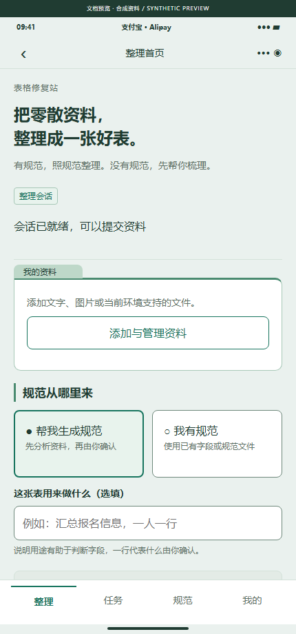
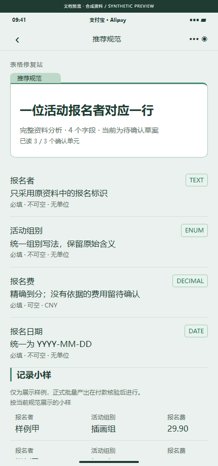
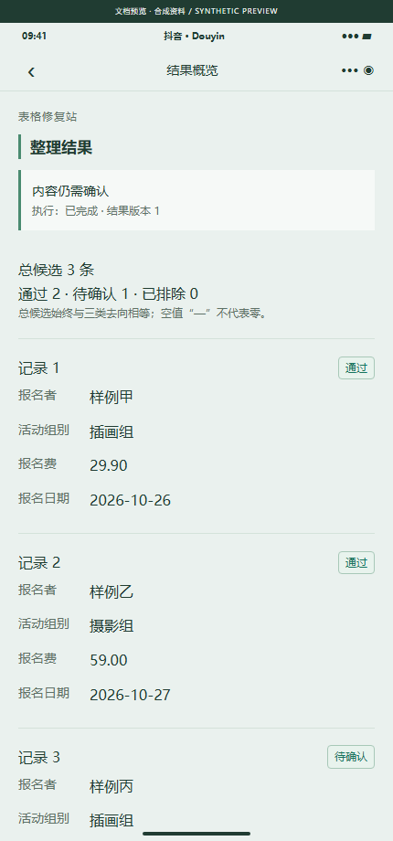
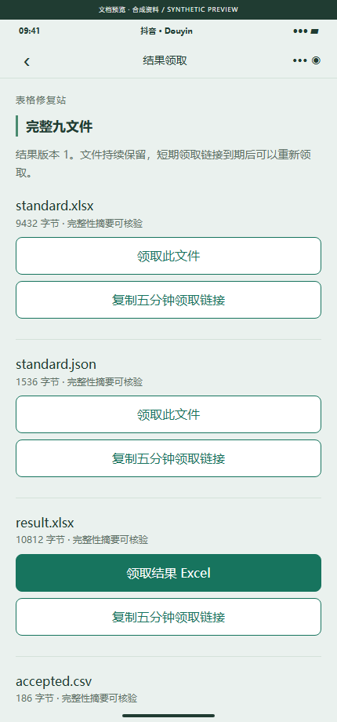

# 截图、录屏与 GIF / Screenshots, recordings and GIFs

[中文项目说明](../../README.md) · [English guide](../../README.en.md) · [复现 / Reproduce](../preview/README.md) · [摘要 / Manifest](manifest.json)

**所有媒体均为实际页面源码的浏览器文档预览，资料及模型、报价、付款、生产和清理状态为合成夹具。不是原生设备、真实 Codex、真实资金或 Ubuntu 清理验收。** 所有截图顶部带预览标识，录屏侧栏持续展示真实性边界。金额只作交互展示，不是产品定价。

**All media show a browser adapter rendering actual native page source with synthetic fixtures. They are not native-device captures or live model/payment/Ubuntu-cleanup acceptance.** Screenshots carry a preview label; the recording shows its boundaries throughout. Demo amounts are not service prices.

## 流程与依据 / Workflow and evidence

[完整 MP4 / Full recording](walkthrough.mp4) · [桌面结果总览 / Overview](overview.png) · [规范审阅 / Schema review](schema-desktop.png)

MP4 为无音轨 H.264 / yuv420p / faststart；流程 GIF 加速播放，来源依据 GIF 展示问题定位与后续领取页面。精确尺寸、时长、大小、编码、SHA-256 见 manifest。

MP4 uses H.264 / yuv420p / faststart with no audio. The workflow GIF is accelerated. The evidence GIF shows source tracing and subsequent export navigation. Exact metadata and digests are in the manifest.

## 关键页面 / Selected pages

   

## 全部 36 页 / All 36 pages

[支付宝 18 页联系表 / Alipay contact sheet](alipay-pages.png) · [抖音 18 页联系表 / Douyin contact sheet](douyin-pages.png)

| 编号 / ID | 页面 / Page | 支付宝 / Alipay | 抖音 / Douyin |
| --- | --- | --- | --- |
| MP01 | 整理首页 / Home | [截图](screenshots/alipay/MP01.png) | [Screenshot](screenshots/douyin/MP01.png) |
| MP02 | 资料清单 / Sources | [截图](screenshots/alipay/MP02.png) | [Screenshot](screenshots/douyin/MP02.png) |
| MP03 | 规范输入 / Schema input | [截图](screenshots/alipay/MP03.png) | [Screenshot](screenshots/douyin/MP03.png) |
| MP04 | 预检与报价 / Plan and quote | [截图](screenshots/alipay/MP04.png) | [Screenshot](screenshots/douyin/MP04.png) |
| MP05 | 处理进度 / Progress | [截图](screenshots/alipay/MP05.png) | [Screenshot](screenshots/douyin/MP05.png) |
| MP06 | 推荐规范 / Schema proposal | [截图](screenshots/alipay/MP06.png) | [Screenshot](screenshots/douyin/MP06.png) |
| MP07 | 字段编辑 / Schema editor | [截图](screenshots/alipay/MP07.png) | [Screenshot](screenshots/douyin/MP07.png) |
| MP08 | 结果概览 / Results | [截图](screenshots/alipay/MP08.png) | [Screenshot](screenshots/douyin/MP08.png) |
| MP09 | 问题列表 / Issues | [截图](screenshots/alipay/MP09.png) | [Screenshot](screenshots/douyin/MP09.png) |
| MP10 | 问题详情 / Issue detail | [截图](screenshots/alipay/MP10.png) | [Screenshot](screenshots/douyin/MP10.png) |
| MP11 | 来源依据 / Evidence | [截图](screenshots/alipay/MP11.png) | [Screenshot](screenshots/douyin/MP11.png) |
| MP12 | 结果领取 / Downloads | [截图](screenshots/alipay/MP12.png) | [Screenshot](screenshots/douyin/MP12.png) |
| MP13 | 任务列表 / Tasks | [截图](screenshots/alipay/MP13.png) | [Screenshot](screenshots/douyin/MP13.png) |
| MP14 | 我的规范 / Private schemas | [截图](screenshots/alipay/MP14.png) | [Screenshot](screenshots/douyin/MP14.png) |
| MP15 | 我的 / Account | [截图](screenshots/alipay/MP15.png) | [Screenshot](screenshots/douyin/MP15.png) |
| MP16 | 订单详情 / Order | [截图](screenshots/alipay/MP16.png) | [Screenshot](screenshots/douyin/MP16.png) |
| MP17 | 隐私管理 / Privacy | [截图](screenshots/alipay/MP17.png) | [Screenshot](screenshots/douyin/MP17.png) |
| MP18 | 帮助售后 / Support | [截图](screenshots/alipay/MP18.png) | [Screenshot](screenshots/douyin/MP18.png) |

每张为 430×920 的源页面视口，长页面可通过本地预览滚动查看；截图不会显示全部滚动内容。源页面文本为当前产品中文，两份 README 和媒体说明均中英提供。

Each capture is a 430×920 viewport; long pages continue below the fold in the local preview. Product UI is Chinese; guides and media explanations are bilingual.

## 来源与验证 / Provenance

- [采集凭据 / Capture receipt](capture-receipt.json)：36 页 + 2 张桌面截图、来源摘要、浏览器资源关闭记录及真实性边界。
- [最终媒体清单 / Final manifest](manifest.json)：包括两张联系表、MP4 和两个 GIF，逐文件大小/摘要与 ffprobe 元数据。
- [验证记录 / Verification](../repository-verification.md)：本轮执行范围；不把预览当作外部验收。

原始 WebM、浏览器二进制和运行日志位于被忽略的项目 runtime，不推送；选定媒体均随源码入 Git。Raw recordings, browser binaries and runtime logs stay ignored; the selected reviewable media are versioned.
