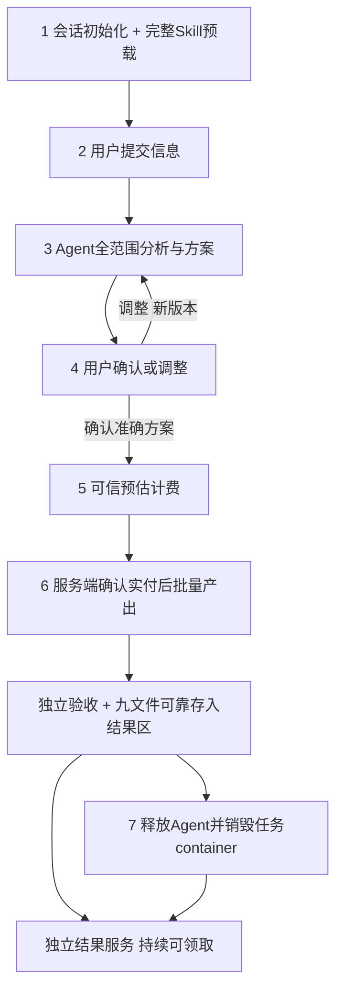

# 统一七步流程与Session生命周期

P07｜业务v3.2｜开发P07-DEV 3.0.0｜2026-10-27｜设计B青绿资料夹1.0.0。设计资料，软件及真实Agent/资金/设备测试未执行。

## 唯一正常处理流程

用户已明确：**结果文件不删除，删除整个流程的container。** 系统按下面七步实施。

| 步骤 | 用户交互 | 后端必须满足的条件 |
| --- | --- | --- |
| 1 创建会话 | 进入新整理任务，先看到准备状态 | 创建独立session/原生隔离工作区，完整装入本业务Skill，核全部文件/hash、上下文及工具/权限，bootstrap成功后READY_FOR_INPUT |
| 2 提交信息 | 上传/粘贴资料、用途和可选规范 | READY前连文字/文件/模板/目标都不接收；SOURCE与TEMPLATE分别存入本任务环境 |
| 3 Agent分析 | 查看资料理解、规范/整理建议、小样及问题 | 全部拟处理范围分析；Agent自主读文件/写分析代码/选择工具；至多5条代表预览，不批量生成正式九文件 |
| 4 确认或调整 | 修改字段、行粒度、规则、范围、冲突/缺失策略，再确认 | 两种模式都先采用准确规范并确认执行方案；调整回第3步，生成新plan版本、旧确认和未付quote失效 |
| 5 预估计费 | 查看明确范围、数量、预估金额与上限 | 报价只能引用当前已确认plan/source/binding/skill；价格由可信计量和获准价格表计算 |
| 6 实付后批量产出 | 原平台支付后查看生产进度与结果 | 服务端验付匹配订单/单位/金额/plan hash才发生产许可，启动一次Run；Agent批量清洗、成表并交独立验证 |
| 7 保存结果并销毁环境 | 领取结果，看到已保存/环境已清理状态 | 九文件复制至独立结果区、hash/readback/持久提交成功，原子发布结果指针及清理outbox；释放Agent并销毁全部任务环境，结果继续可下载 |

登录、必要告知、能力和限频是任务的前置资格检查。所有新增处理任务，无论首页/模板/结果再加工、支付宝/抖音/未来Web/API，都从S1开始。同一未结束任务重连找回原session，不能每次切页重复建环境；已销毁session不复活。查看已有结果不属于新处理任务。

## 完整Skill的准确含义

本业务版本发布包列出SKILL.md、全部references、工具脚本/说明及资源清单。Host在客户提交任何内容前读取全部资源、校hash，将完整内容装配进受信任bootstrap上下文，并核实际上下文容量、工具/权限/认证后执行初始化。仅展示name/description、把文件放磁盘或让模型回声hash，都不满足加载完成。缺件/hash错/上下文放不下/工具失败必须初始化失败、回收已分配环境，不能降为懒加载。

Codex官方技能默认逐步加载；本产品明确使用Host的EAGER_FULL策略，不宣称存在`preloadAllSkills`开关。上下文压缩或恢复后，在继续客户turn前重附完整锁定Skill和当前不可变业务控制事实。Skill版本/hash参与计划与报价；中途不静默升级。第三方库是已安装工具依赖，不是要把全部依赖源码塞入技能正文。

本版skill包是完整的业务设计资源，尚未实现SDK注入、bootstrap、工具程序或真实加载测试。后续真实工具脚本纳入同一版本清单并实证，才能开放真实会话。[官方Skill加载说明](https://learn.chatgpt.com/docs/build-skills)。

## 付费前与付费后

付费前完成完整资料理解、规范推荐、关键策略澄清、方案确认与小样。完整分析不是只看前三单元；小样只是展示方式。初始化/分析/调整成本由平台承担，有独立、有限的时间/调用/次数/闲置预算，实测锁定前不开服务；不能在用户付费时倒收未确认的前置成本。

付费后执行已确认方案的正式批量清洗、跨源拆合、字段与来源处理、九文件和独立验证。Agent可以在预算内换工具、写代码和修复候选，但不能改规范/价格、调用支付/退款/DB、代用户确认或自行发布。

报价说明数量、范围、原单位金额、费用上限、限制与交付。LLM给难点/计量建议，可信计量与价格表才是售价依据。默认固定确认范围与封顶金额；超限停止说明，不能隐藏加价。UNKNOWN、客户端success、过期报价、plan hash错或伪free_grant均不发生产许可。无获准收银能力时关闭收费生产路径；测试夹具不是消费者免费绕过。

## container销毁与结果保留

运行区例：`runtime/sessions/<server-session-id>/`，包含只读输入、上下文、Agent代码、分析/OCR/缓存、候选、checkpoint及任务日志；临时接收/受控溢出副本也绑定该生命周期。结果区例：`runtime/results/<owner-id>/<result-id>/`，独立权限/归属与九文件。结果不能是指向工作区的junction、软链接、临时路径或待删副本；仅rename一个文件还不足以证明独立持久提交。

顺序固定：候选验收 → 复制全部结果到独立存储 → 回读/核hash与实际存储持久提交 → 原子发布结果指针及清理outbox → fence/中止并回收Codex与工具进程树 → 撤销挂载/任务权限 → 删除整个任务环境及受控副本 → 核实清理 → 留最小回执。清理器由可信Host控制，不能让Agent自己写清理脚本并声称成功。

删除：原始上传/接收副本、客户会话正文、Codex任务落盘上下文、分析/预览、中间表、生成脚本、OCR/抽取缓存、scratch、原始stdout/stderr、checkpoint及非结果DB正文/缓存。保留：最终九文件、由结果生成的记录/问题/来源投影、最小结果归属/hash、用户主动保存的私有规范、必要订单/支付及清理凭据。公共Skill、运行时二进制与其他任务不能被清理。

结果中的必要来源摘录与定位可以保留，原始全文档不作为隐蔽“结果副本”保存。环境销毁后来源页明确原件已清理，只展示结果内可用证据；不能继续伪装可看完整原件。结果文件不因销毁container或短链TTL到期被删除，下载只依赖结果权限，短链可重签。用户日后主动删除结果属于单独数据管理动作，不由流程结束自动触发。

本地不启动Docker、WSL、虚拟机或MXC；container是任务隔离运行环境抽象。具体原生SDK/会话落盘/受限身份/进程/缓存删除需试验。不能声称SDK一个close调用自动擦除一切；平台供应商副本/备份按经验证合同处理，未确认不承诺物理零留存。

## 失败、取消、等待与再加工

初始化失败、未付任务闲置到期、用户取消、最终失败都要终止并清理环境；已有独立结果不删除。等待确认/付款不占活跃计算，有限闲置期限需显示并在配置锁定，未付环境不无限驻留。支付未知先查原订单，晚付按原订单事实履约/退款，不自动复活已清环境。

保存失败不可当作产出成功销毁唯一可恢复材料；按已付合同恢复或失败/退款。结果已保存但清理失败时结果仍READY，cleanup为PENDING/FAILED并幂等重试告警；不能把发出删除请求写SUCCEEDED，也不能为重试清理重跑生产/收费。进程崩溃后outbox继续清理，关闭会话不可从旧备份/checkpoint复活。

产出后调整从新session和完整Skill开始，用户选取父结果及必要重传原件作为新输入，再分析/确认/估费/核实付款权益。业务修订可以关联父结果/child Run，但不能恢复旧runtime。平台纠错可核原实付权益覆盖，不伪造新付款或向用户二次收费；新增需求按新确认报价付费。

## 版本影响与执行状态

业务升级v3.2，开发升级P07-DEV 3.0.0；v3.1/DEV2原样归档。42功能/126AC/24BR/18NFR/8指标/24异常/18页继续追踪，API新增3项session接口共56项，API18—20转为task路径，因为采用发生在付款和Run创建之前。原“先付费发现后采用”、前三单元局部预检作为主路径、付费Run等待规范、消费者free_grant生产及自动7天删结果退出当前流程。

执行Run只使用QUEUED/RUNNING/SUCCEEDED/FAILED/CANCELED；付费前等待发生在Session WAITING_CONFIRMATION/AWAITING_PAYMENT。Session CLOSED、结果READY及清理SUCCEEDED分别记录。产品/SDK/加载/清理/资金/设备测试均NOT_RUN，当前完成的是设计与合同更新。
