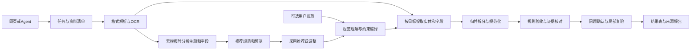

# 表格修复站：架构、数据与接口

> 历史v2.1：2026-10-27由“小程序优先、Web进阶”的v3.0替代，保留当时网页优先方案。当前需求见[PRD](../../01-产品需求PRD.md)。

P07｜v2.1｜2026-10-27｜多源资料成表。自有接口设计稿，不是任何支付/OCR/模型供应商的现成API。

## 架构与执行边界



业务服务、原生任务Worker、关系数据库及受控文件存储组成模块化系统；解析器、OCR/视觉模型、语义提取器、归并器、校验器和导出器分开。代码位于src/web、src/api、src/engine，运行目录为本项目runtime。禁止本地Docker/WSL调度。

文件读取在限时限量的原生子进程中进行，不执行内容。必要内容进入经批准OCR/LLM适配器；模型返回结构化候选与证据引用，不能直接改数据库规则/触发支付。原生进程边界不是对任意恶意代码的安全沙箱，因此不接受运行附件代码。

## 三种核心合同

1. SourceSetVersion：本次文本、文件、选定页/表和明确排除项，保留哈希和角色；角色包括SOURCE与TARGET_TEMPLATE，示例不是来源事实。
2. SchemaProposal/SchemaVersion：提案记录结构发现依据、字段/主题覆盖、建议和不确定点；已采用规范记录列/类型/必填/枚举/单位/粒度/归并及批准规则，origin为PROVIDED或DISCOVERED。不能把观察到的规律直接当业务强约束。
3. TaskContract：已有规范模式冻结源集/规范/目的/预算/报价；DISCOVER先冻结源集、目的、schema_mode、规范发现交付和同一总价。首次采用后追加SchemaBinding记录proposal/version/hash/actor，不改原报价和支付摘要；执行填表前须有有效绑定。规范后续修订另建绑定及影响记录，不能静默覆盖。

## 规范编译与字段状态

规范列至少含field_id、label、order、type、required、nullable、enum、pattern、unit、precision、scope、description。行粒度含record_kind与identity_keys；key只是确认的业务关系，不能凭相似名字发明唯一键。跨字段表达式使用受限规则语言，不执行eval或用户Python。

字段状态：EXTRACTED（直接有证据）、NORMALIZED（按规则转换）、DERIVED（明确表达式）、DEFAULTED（批准默认）、USER_PROVIDED（人工）、MISSING、CONFLICT、UNREADABLE。状态不等于可信概率；可选的模型评分与平台判定依据分开。

类型、格式或唯一检查通过仍可能存在抽取错误。自动接受至少要求支持来源引用、无未解冲突、符合规范及当前任务允许的证据政策；高风险标识/OCR歧义需明确标问题。允许文本中的事实无需逐格人工确认，但需要标准答案与质量门槛支持。

## 无模板分析、采用与状态

完整结构分析读取约定资料范围，提出主题/对象/候选字段/同义关系、推断类型/单位、缺项分布、推荐约束与未纳入项。字段出现率的分母必须说明是哪些相关候选记录，不能混用页数或拿局部样本代表全量。无稳定业务键时保留各事件，不以内部ID证明业务唯一。

proposal_status为PARTIAL_DRAFT、FULL_DRAFT、ADOPTED、SUPERSEDED；schema_mode为PROVIDED/DISCOVER。DISCOVER运行可进入WAITING_SCHEMA，展示草案/预览，schema_binding为空时不能产生正式PASSED。用户只需一键采用推荐方案或修改少量关键内容，不逐格批准事实。采用请求携带expected_proposal_version/source_hash/goal_hash，旧版返回冲突，不能从旧草案覆盖新结果。

全范围草案及预览就绪记workspace_ready_at；已有规范为首版结果就绪。24小时人工窗口与计算预算分开，规范首次采用/采用前同目的调整在原合同内。冻结后新重要字段进入变更建议和未映射报告，不能通过删列/放宽规则降低目标。结构发现质量由独立人工标注与信息覆盖审查验证，不以自定schema通过率证明合理。

## 数据模型

| 实体 | 关键数据 | 约束 |
| --- | --- | --- |
| Task/SourceSetVersion | tenant、source_ids、说明、hash、范围、选中/排除 | 来源集合不可变，排除需用户同意 |
| SourceAsset | role、mime、sha256、bytes、parse_status、expires_at | 源只读，模板与事实隔离 |
| SourceUnit | source_id、page/sheet/paragraph/cell/bbox、text_ref、status、reason | 每个解析单元有终态和使用关系 |
| SchemaProposal/FieldSuggestion | source/goal版本、粒度候选、字段理由/来源、出现分母、未纳入项、状态 | 局部/全范围有别；不把统计规律冒充已确认业务规范 |
| SchemaVersion/FieldSpec/SchemaBinding | origin、列/约束、粒度、键、approved_by、proposal/version/hash | 采用时固定，所有权和版本验证；样例不进实体集合，规范不可覆盖 |
| PlanVersion | 提取策略、归并/拆分、优先级、需澄清、rule_hash | 用户说明优先于系统推测；来源内容无操作权限 |
| CandidateRecord | entity_id、record_kind、disposition、字段状态 | 每候选唯一去向，允许一源多行/多源一行 |
| FieldValue/EvidenceLink | 原值、规范值、status、unit_id、span/bbox、rule/model版本 | 引用必须属于本任务；无来源值明确归为派生/默认/人工或缺失 |
| Relation/Issue/Decision | 拆合关系、冲突候选、缺项、规则、选择、操作者 | 相似度不等于自动归并；决定有版本 |
| Run/Stage/Attempt | source/schema/plan版本、阶段、检查点、预算、deadline | 保存模型/OCR输出；恢复不随机重抽已冻结阶段 |
| ResultVersion/Validation | 候选去向、字段问题、覆盖、quality_status、parent_version | 数据和验收同版本发布，不覆盖旧版 |
| Quote/Order/Payment/Refund | 合同hash、金额分、SDK引用、状态 | 继承共用幂等和交易规则 |
| Artifact/Audit/Outbox | kind、sha256、内容ref、expires、actor、event_id | 全清单验完后发布权益，追加审计/事务发件箱 |

金额与精确数量在JSON中用十进制字符串，标识用文本。币种和单位独立；汇总按对象粒度/业务字段/币种/单位分别定义，未知不当0。每个模型输出值必须关联抽取阶段和证据，不能凭最终生成表反向捏造来源。

## 覆盖与验收算法

资料先生成清单，解析后创建可定位单元：文字段落/表格行、PDF页内块、图片OCR区域等。每单元恰有USED、PARTIAL、UNUSED、UNREADABLE之一；多个字段可引用同一单元，同一记录可引用多个单元。UNUSED须说明无关/未采用，UNREADABLE属于范围缺口，除非用户明确将其排除并形成新范围。

候选记录唯一分为ACCEPTED、NEEDS_REVIEW、EXCLUDED，candidate_count等于三者之和；这只是候选去向完整性，不证明没有漏抽实体。source_coverage、field_constraint_pass、evidence_check、quality_status分别报告。语义召回用独立人工标注集评价。

quality_status为PASSED、NEEDS_REVIEW、BLOCKED；run_state为QUEUED/RUNNING/WAITING_SCHEMA/SUCCEEDED/FAILED/CANCELED。SUCCEEDED表示系统处理及完整产物生成，并不自动等于PASSED。PASSED要求有效的规范绑定、约定范围无未解决读取缺口、非移出候选满足验收条件及无未解关键问题；规范合理性/重要信息覆盖另有审查结果，但不是对所有事实绝对真实的保证。

## 固定交付合同

| 文件 | 必须内容 |
| --- | --- |
| standard.xlsx | 当前采用规范的空主表与规则说明，标版本/来源；不夹带真实样例、证据摘录或任务访问引用 |
| standard.json | 可复用字段/类型/规则/粒度合同，含schema版本与origin，不带任务内对象引用；采用审计单独保留 |
| result.xlsx | 主表按规范列和顺序写全部未移出候选；问题值留空/按规范表示。独立_states、_issues、_sources、_excluded附表，不污染目标列 |
| accepted.csv | 仅ACCEPTED行，UTF-8/BOM配置冻结，目标列顺序；危险文本安全处理有披露 |
| result.json | source/schema/result版本、records、每字段value/status/evidence、去向、issues；数据全量可机读 |
| issues.xlsx | entity/field、问题码、候选原值、来源、需用户动作 |
| provenance.jsonl | 字段级来源/转换/归并/默认/派生/人工决策记录，含必要证据摘录及坐标 |
| validation.json | 规范绑定/合理性审查、字段与主题覆盖、未映射重要信息、规范检查、候选去向、解析覆盖、未读范围、派生/人工数量及局限 |
| manifest.json | 文件名、大小、SHA256、schema/result版本、过期时间 |

正式结果9文件同时生成；无规范时草案/预览经单独工作区接口提供并标DRAFT，尚不算完整正式交付；两种结果政策均须先采用规范。没有通过行时accepted.csv只含表头，不捏造空记录。manifest列其他八个产物的哈希，下载API另给manifest自身哈希，避免文件自引用哈希问题。主表不会静默丢列；未归入规范的来源信息在来源单元清单保留引用及必要摘录，不承诺复制所有原资料正文到附表。

## 自有API

基路径/v1/p07。写入有租户作用域Idempotency-Key，键同摘要返回原资源，键同但摘要不同返回409。认证、支付凭证和文件归属不依赖客户端tenant_id。状态/错误可机读，正文不带密钥/内部路径。

| 方法与路径 | 业务合同 |
| --- | --- |
| POST /tasks | 创建任务及可选目标说明、schema_mode；DISCOVER不要求standard_id |
| POST /tasks/{id}/sources | 粘贴文本或上传附件，明确SOURCE角色 |
| POST /tasks/{id}/standard | 规范文件或字段定义，TARGET_TEMPLATE角色 |
| POST /tasks/{id}/preflight | 返回读取清单、推断规范、关键澄清、预算；可限量预览 |
| POST /tasks/{id}/confirmations | 确认源范围/目的/模式/排除/政策；PROVIDED同时绑定明确规范，DISCOVER后续追加采用绑定 |
| POST /tasks/{id}/quotes | 服务端计算总价和范围/上限/时限/修订条款 |
| POST /tasks/{id}/runs | 绑定quote与contract_hash；真实SDK提供402/授权操作；获准后执行 |
| GET /runs/{id} | 执行、schema_mode/提案/绑定、验收、支付、退款、预算、阶段、workspace_ready_at与revision窗口 |
| GET /runs/{id}/schema-proposal | 返回局部/完整推荐规范、字段依据、预览、覆盖和未纳入项 |
| POST /runs/{id}/schema-proposal/revisions | 采用前原目的内调整，带expected_proposal_version，形成新草案 |
| POST /runs/{id}/schema-adoptions | 一键采用确切草案/版本，生成不可变SchemaBinding，恢复自动整理 |
| GET /runs/{id}/records | 分页表格，filter=needs_review等；根据合法权益决定可见范围 |
| GET /evidence/{id} | 授权后返原文片段/来源页区域/到期信息，不能用引用越权读取 |
| POST /runs/{id}/decisions | 问题选择/人工补充/规则确认，带expected_result_version |
| POST /runs/{id}/revisions | 原范围内复验，扣成功受理的一轮；平台纠错不扣 |
| GET /runs/{id}/artifacts | 当前或指定结果版的固定文件清单 |
| POST /artifacts/{id}/download-link | 权益内5分钟签名，重复免费 |
| POST /runs/{id}/cancel | 取消并返回最终执行/退款状态 |
| POST /runs/{id}/tickets | 系统错误/售后请求 |

自有结果示例：

```json
{
  "run_id": "run_example",
  "run_state": "SUCCEEDED",
  "quality_status": "NEEDS_REVIEW",
  "payment_state": "SUCCEEDED",
  "schema_version": "std-v1",
  "result_version": 1,
  "counts": {"candidates": 3, "accepted": 1, "needs_review": 2, "excluded": 0},
  "source_coverage": {"processed_assets": 3, "unreadable_units": 0},
  "semantic_recall": "NOT_MEASURABLE_FOR_THIS_LIVE_TASK",
  "revision_rounds_remaining": 2
}
```

STANDARD_REQUIRED仅在用户明确选择PROVIDED却未给规范时使用，允许切换DISCOVER；错误另含SCHEMA_ADOPTION_REQUIRED、PROPOSAL_VERSION_CONFLICT、SCHEMA_AMBIGUOUS、SOURCE_UNREADABLE、SCOPE_EXCEEDED、EVIDENCE_INVALID、BUDGET_EXHAUSTED、PAYMENT_UNKNOWN、RESULT_VERSION_CONFLICT、REVISION_WINDOW_CLOSED、ARTIFACT_EXPIRED。外部SDK协议头/签名/结算字段以实际接入为准，不用这里的示例冒充。

## 阶段恢复、计费与隐私

事务保存执行许可、任务和发件箱，阶段产物校验后标检查点；模型/OCR响应保存版本，失败阶段最多一次自动重试。参数/规范不变时复验基于保存的提取与人工决定，不承诺不同模型重新运行逐字一致。旧attempt用token/版本防覆盖。

最终结算时点必须用SDK验证；24小时人工修订不是自动假定付款授权可以保持24小时。可用模式须符合“处理服务＋问题工作区＋修订/退款”的合同；若不支持，先调整获准收款/履约方案再售。不得用假同步结果掩盖长任务。

源内容必要时进入外部OCR/LLM，因此上传/执行前告知处理方、地域与必要内容范围；不把通用抽取仍描述为只发5行脱敏样例。结果证据摘录可能保留7天，即使源文件更早清理；原件到期后只提供仍有效的报告证据，明确不能重新打开原文件。
