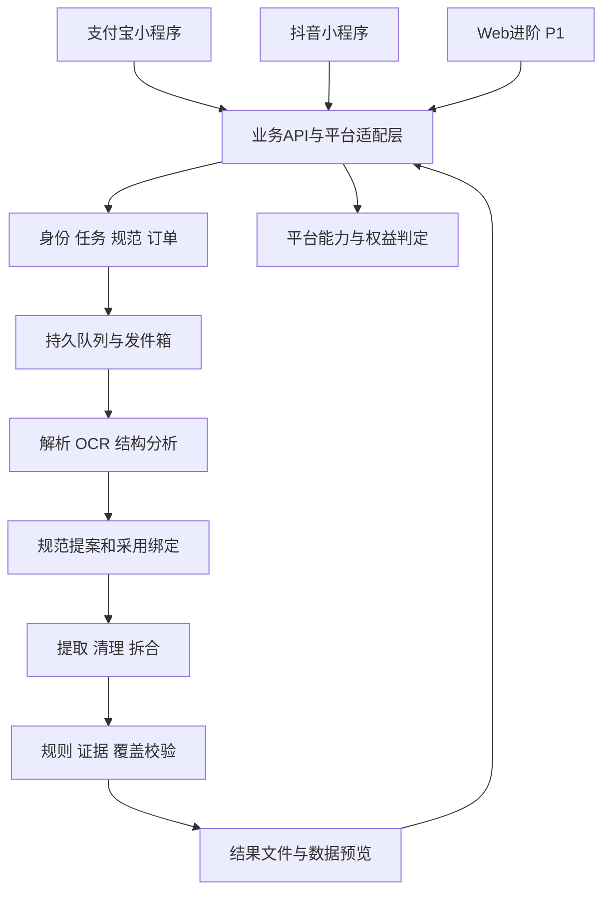

# 表格修复站：架构、数据与接口

P07｜v3.0｜2026-10-27｜自有业务设计，尚未实现；外部SDK/API以各端获准文档和真实契约为准。

## 双端与共享内核

建议采用双端原生小程序界面＋共享TypeScript业务模型/纯状态逻辑。src/mini-alipay、src/mini-douyin分别持有宿主适配；src/shared不引用my/tt，包含合同类型、状态展示、字段与单位规则。src/web为P1，src/api为模块化业务服务，src/engine为原生解析/OCR/模型Worker。API与Worker技术依赖开发时锁版本，不以目录创建代表代码可运行。

业务数据库、受控对象存储、持久队列/事务发件箱分工明确，付费/回调并发用支持事务唯一约束的数据库。仅使用Windows原生进程/已有工具，不调度Docker/WSL/虚拟机。解析在限资源原生子进程执行；不运行附件宏/代码，进程边界不等于任意恶意代码沙箱。

## 平台适配合同

| 适配接口（自有） | 输入/输出 | 约束 |
| --- | --- | --- |
| authenticate | 宿主临时凭据→服务端会话 | provider/app_id/subject；密钥不进客户端，拒绝重放 |
| getCapabilities | 平台/OS/版本→服务端核定开关 | 客户端上报不决定支付资格，结合版本白名单/商户配置 |
| selectSources | 用户主动选择→本地临时描述符 | 文件选择、上传是两能力；未证明的办公文档入口不可伪造 |
| uploadSource | 单文件→持久SourceAsset | 队列、摘要去重、取消/失败状态，临时路径不作服务器凭据 |
| startCheckout | 订单→对应平台支付指令 | 只收服务端冻结价，SDK载荷不跨平台使用 |
| openOrExport | 产物→宿主/用户动作回执 | FETCHED/CACHED/OPEN_REQUESTED/USER_CONFIRMED等独立，不伪造系统保存结果 |
| requestNotification | 用户选授权→订阅结果 | 非主流程依赖，不默认订阅/手机号授权 |

域名、HTTPS、证书、业务域名、回调、基础库版本各端登记。支付宝境内API未取得可读正文的条目记待核验，不拿Alipay+同名API证明境内能力。抖音上传/预览/存储差异及iOS规则冲突见[平台专项](小程序/03-双平台能力与文件进出.md)。

## 核心版本与状态

SourceSetVersion冻结源角色/哈希/选中和排除，SchemaProposal记录主题/字段/粒度建议、覆盖分母、依据、不确定点；SchemaVersion记录已明确约束，SchemaBinding记录采用者、提案/源/目标/规范版本与hash。模板样例不进事实集合。PROVIDED先明确规范；DISCOVER先冻结源/用途/模式/预算/费用，后续采用追加绑定，不更改原支付摘要。

规范状态PARTIAL_DRAFT/FULL_DRAFT/ADOPTED/SUPERSEDED；Run为QUEUED/RUNNING/WAITING_SCHEMA/SUCCEEDED/FAILED/CANCELED；quality_status为PASSED/NEEDS_REVIEW/BLOCKED。无有效绑定不可PASSED。SUCCEEDED只代表执行与完整产物已生成，不能同时推定规范通过、资金到账、设备已导出。

workspace_ready_at：PROVIDED为首版结果，DISCOVER为完整规范草案＋预览就绪；拟定24小时审阅/两轮修订政策须符合平台商品合同，人工等待和累计计算预算分开。旧attempt/客户端旧版本不能覆盖新结果，修改携带expected_version。

## 领域模型

| 实体 | 关键字段/约束 |
| --- | --- |
| PlatformIdentity/Session | provider/app_id/subject、account、会话与撤销；不按昵称/手机号合并 |
| AccountBinding | 双方验证、同意、撤销；记录共享范围，不自动共享付费权益 |
| Task/SourceSetVersion | tenant、origin_channel、目标/模式、源范围和哈希，不可变 |
| SourceAsset/Unit | role、mime、sha256、bytes、parse_status、page/sheet/paragraph/cell/bbox、expires |
| SchemaProposal/FieldSuggestion | topic、row_kind、候选字段、单位/规则、依据、相关记录分母、未纳入项 |
| SchemaVersion/Binding | origin、字段/列序/约束/粒度/归并、采用版本/操作者/哈希 |
| PrivateTemplate/Version | owner、无真实源值的规则快照、命名/版本/删除/保留政策，独立于任务原件 |
| CandidateRecord/FieldValue | disposition、字段value/status、原值/单位/币种、rule/model版本 |
| EvidenceLink/Relation | 本任务来源坐标/摘录、拆合及理由、派生依赖、人工决定 |
| Issue/Decision/ResultVersion | 原因/候选/用户动作、expected_version、校验及父版，旧版不覆盖 |
| Run/Stage/Attempt | 预算/阶段/检查点/租约，模型/OCR输出冻结，恢复不随机重抽已完成阶段 |
| Quote/Order/Payment/Refund | origin平台/app/OS、商品合同、计价单位、金额/数量、原生流水、独立状态/幂等 |
| Artifact/ExportAttempt | hash、大小、版本、到期；设备获取/缓存/打开/导出动作与回执来源 |
| CapabilityEvidence/ReleaseGate | 平台/OS/宿主/基础库、审核/文档/真机证据、开关、日期 |
| Audit/Outbox/RetentionJob | 追加审计、事务副作用、清理标记/重试，日志无正文密钥 |

## 提取、规范和独立校验

规范含field_id/label/order/type/required/nullable、枚举开放性、pattern、unit/precision、description、row_kind和有依据的identity_keys。只出现过的值不直接组成封闭枚举，样本不重复不证明唯一。无稳定键保留报价/报名等事件，不凭同名自动合并。

字段状态EXTRACTED、NORMALIZED、DERIVED、DEFAULTED、USER_PROVIDED、MISSING、CONFLICT、UNREADABLE；明确批准的默认/派生与人工值不能冒充来源事实。精确数值用十进制字符串，标识保留文本/前导零；无锚点相对日期不猜，币种/单位/对象粒度不明不汇总分摊。

每来源单元有USED/PARTIAL/UNUSED/UNREADABLE及原因，多对多证据关联允许一源多行/多源一行。候选恰属ACCEPTED/NEEDS_REVIEW/EXCLUDED，数量守恒只证明候选去向，不证明语义零漏抽。重要字段/主题覆盖、规范合理性、规则符合、证据和解析覆盖分别报告；模型自评分不能独自通过，独立人工标准答案衡量准确/召回/关键字段覆盖。

## 固定9文件与移动投影

| 文件 | 内容 |
| --- | --- |
| standard.xlsx | 已明确规范的空主表及规则说明，版本标识，不含真实源样例 |
| standard.json | 可复用字段/类型/规则/粒度合同，不带原任务访问引用 |
| result.xlsx | 全部未移出候选，目标列序/基础格式；_states/_issues/_sources/_excluded附表 |
| accepted.csv | 仅通过行，编码/BOM固定；公式危险文本安全处理与披露 |
| result.json | 全候选/字段状态/来源、版本/规范/问题，不只是摘要 |
| issues.xlsx | 行/字段问题、候选、来源及用户动作 |
| provenance.jsonl | 字段提取/转换/拆合/默认/派生/人工记录与必要摘录 |
| validation.json | 规范绑定、合理性/信息覆盖、规则/证据/候选/资料范围及局限 |
| manifest.json | 其他8文件名/大小/哈希/版本/到期，自身哈希由接口另给 |

固定包缺文件不标交付完整；空集有表头/schema，0候选不捏造一行。手机从分页records和问题摘要生成卡片，详情按需取证据缩略/片段；不一次下载全量JSON/全部原图/9文件，也不把XLSX渲染成手机唯一界面。PDF页图可按需生成授权预览，原件与渲染内容依各自期限清理。

## 自有API草案

全部/v1/p07，认证归属由服务端决定。写入带租户＋动作作用域Idempotency-Key和请求摘要；同键同请求返回原资源，同键不同请求409。下表是自有合同，非支付宝/抖音官方接口。

| 方法与路径 | 业务合同 |
| --- | --- |
| POST /auth/platform-sessions | 交换宿主临时凭据，服务端校验平台/app |
| GET /capabilities | 当前端/OS/版本可用输入/交易/导出/隐私能力 |
| POST /tasks | 创建资料任务，模式/可选用途/来源渠道 |
| POST /tasks/{id}/sources | 文本或文件，SOURCE角色；完成校验后计入源集 |
| POST /tasks/{id}/standard | 规范文件/私有模板/字段定义，TARGET_TEMPLATE |
| POST /tasks/{id}/preflight | 可读性/范围/局部建议/关键澄清/预算，不冒充全量 |
| POST /tasks/{id}/confirmations | 固定源/用途/模式/排除/政策；PROVIDED绑定规范 |
| POST /tasks/{id}/quotes | 按实际渠道商品及预算报价，显示单位/上限/期限 |
| POST /orders | quote/contract绑定原平台，服务端创建对应订单 |
| POST /orders/{id}/checkout | 回对应平台获准收银指令，未获准OS拒绝 |
| GET /orders/{id} | 服务端确认支付/退款/履约，客户端回调不直接记账 |
| POST /tasks/{id}/runs | 同合同原订单已核验的许可后执行；不是消费者402接口 |
| GET /runs/{id} | 执行/规范/质量/支付/退款/窗口/版本独立返回 |
| GET /runs/{id}/schema-proposal | 局部/完整推荐、依据、预览及覆盖 |
| POST /runs/{id}/schema-proposal/revisions | 采用前原用途内调整，带expected_proposal_version |
| POST /runs/{id}/schema-adoptions | 采用确切提案/源/目标版本，追加绑定 |
| GET /runs/{id}/records | 游标/状态/字段分页，默认20行，返回过滤前后计数 |
| GET /runs/{id}/issues | 问题分类、影响、分页与候选 |
| GET /evidence/{id} | 归属/到期校验后给片段/页图，不暴露内部路径 |
| POST /runs/{id}/decisions | 决定或补值，带expected_result_version和明确作用范围 |
| POST /runs/{id}/revisions | 按含轮次/平台纠错政策复验，失败恢复不重扣 |
| GET /runs/{id}/artifacts | 指定版本固定9项及期限，设备导出另查 |
| POST /artifacts/{id}/download-link | 当前权益内5分钟签名，可续，不是公开长链 |
| POST /artifacts/{id}/export-attempts | 记录端能力/动作/用户确认，不能伪造操作系统回执 |
| POST /private-templates | 用户主动另存规则快照，去源值/引用后独立版本 |
| GET /private-templates | 仅当前所有者列表，支持详情/新版本/删除 |
| POST /runs/{id}/cancel | 条件更新确定取消/完成竞态与退款 |
| POST /orders/{id}/tickets | 售后/删除/导出故障等工单 |

平台回调独立公网入口，原始验签、事件落库、金额/商品/平台/app归属校验后幂等推进。账号绑定/接力票据仅在相应发布方案获准时开放，双向验证/短期单用途，不能靠知道task_id读取资料。P1开放Machine Pay另建适配，不复用消费者收银凭证。

## 恢复、文件与预算安全

事务提交后才发队列，检查点校验后发布；旧attempt/version防覆盖。前台轮询可逐步退避，后台关闭轮询/上传启动，onShow重取服务端，网络未知先查，不默认重付。上传摘要相同先明确复用同源或允许不同业务角色，不能简单按文件名/相同内容跨租户合并。

解析、OCR、模型、规范调整和修订均计预算；平台权限失败不视作模型失败无限重试。任意URL/文档注入不获得访问、执行、付款或改规范权限。实际依赖、正式SDK字段、最小基础库与端侧缓存上限须在实施记录固定，未验证不以设计接口冒充平台已支持。

接口请求/响应、分页、版本、独立状态及错误合同详见[接口载荷专项](小程序/08-接口载荷与状态合同.md)。平台SDK参数不属于本文自有协议。
