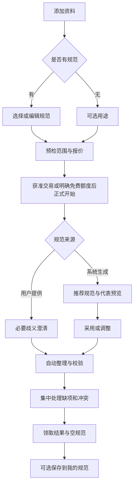

# 表格修复站：小程序产品形态与功能分层

P07｜v3.0｜2026-10-27｜需求设计，尚未开发。上位基线：[产品PRD](../01-产品需求PRD.md)。

## 要解决的问题与核心价值

用户手里的材料不是一张现成的干净表：报名信息在聊天文字、采购信息在PDF、商品参数在截图，称呼、单位和格式也不同。困难包括读完全部资料、想出合理表头、识别同一对象、填列、找出遗漏以及核对事实。产品把这些步骤连起来，交付可使用、可复用、可核对的表格，而不是只给整理建议。

首版服务有临时整理需求的个人、小商家和小团队经办人，优先验证报名/联系人整理、采购或报价明细两类场景。金融审计、自动法律判断、医疗决策不作为试点承诺；不能以本工具整理结果替代专业审核。客户资料必须有处理授权，演示只用合成材料。

| 用户任务 | 原有困难 | 首版期望结果 |
| --- | --- | --- |
| 按公司表格交资料 | 材料多、列名不同、复制易漏 | 上传规范与材料，自动归入列，缺项集中处理 |
| 不知道表该怎么做 | 缺少字段、粒度和规则设计经验 | 只交材料，看到系统建议的规范及理由，采用即可整理 |
| 同一对象出现在多份资料 | 同名、不同单位、信息冲突 | 自动做有依据的归并，冲突让用户看来源决定 |
| 手机现场采集后整理 | 难在手机编辑大宽表 | 记录卡、问题卡和字段详情完成处理，再领取Excel |
| 下次继续相同工作 | 每次重做表头与要求 | 主动保存私有规范，新任务直接复用 |

价值验证要比较同样材料下的人工整理时间、需要用户回答的问题数、漏记录/错字段以及最终能否取用文件。不用“规则通过率100%”证明事实准确或节约时间；用户效率目标在访谈和试用后定量，不虚构提升比例。

## 产品载体

支付宝与抖音小程序都是首版主载体。普通用户在任一已发布、已验证的端内完成完整业务；二者共享业务规则和后端，分别实现宿主登录、授权、文件、交易和生命周期。原生适配是目标，并不声称现已开发。

Web作为P1大屏工作台，适合多列编辑、材料和结果并排、批量规则及更复杂管理。用户不需要购买或打开Web进阶版才能完成首版普通整理。可选、获准的文件接力/领取页面只承担文件传递，不等于交付了Web进阶版，也不作为受限平台的收款通道。

双小程序×iOS/Android四个发布单元分别标能力；某单元文档入口或真实导出尚未证明，就标受限内测并限制相应承诺。不能把后端能读PDF写成手机一定能选择PDF。

## 两种首版模式

**我有规范（PROVIDED）。** 用户添加材料，选择私有规范、上传规范文件，或在手机填写字段。系统读懂目标列、顺序、类型和规则，显示一行代表什么、哪些是样例、哪些是验收条件。确认后整理。用户无须逐列把材料手动映射到表格。

**帮我生成规范（DISCOVER）。** 用户只添加材料，可补一句用途，如“整理每次供应商报价”。系统分析内容，建议行粒度、字段、同义关系、单位和必要规则，展示代表预览、依据及未纳入的信息。用户一键采用，也可说“把每个商品拆开”“加保修期”，随后自动整理。不得要求用户先有标准表才能进入这条流程。

规范模式与STRICT_STANDARD/BEST_EFFORT_REPORT是两个维度：前者决定规范来自哪里，后者决定购买前约定的内容验收/问题交付政策。两模式都可以有缺事实或冲突，都不能补造。

## P0、P1和限制

| 范围 | P0双小程序 | P1进阶/独立扩展 |
| --- | --- | --- |
| 输入 | 主动粘贴、图片、经过各端验证的支持文档路径、规范复用 | 音视频、更多格式、经授权连接外部资料 |
| 规范 | 用户规范、系统推荐、手机字段编辑、采用与版本、私有保存 | 复杂多表关系、组织级规范协作 |
| 整理 | 自动抽取、清理、归并/拆分、覆盖/证据/规则校验 | 更大规模、增量、多任务联动 |
| 审阅 | 记录卡、问题列表、单条字段/证据、选列预览、明确范围决定 | 大屏多列批改、来源并排、协作审核 |
| 交付 | 九文件合同，手机突出结果/空规范/问题，真实可取用 | 获准外部回写、开放SDK/MCP |
| 账号交易 | 双端独立登录、原渠道订单/退款、隐私、任务恢复 | 经规则验证的跨端绑定/权益；Machine Pay开放API |
| 载体 | 支付宝、抖音各有原生页面及能力适配 | Web进阶工作台 |

首版每任务一个主要结果表。遇到联系人与订单、订单与明细混在一起，推荐本次主表并说明未纳入项；不能为凑一张表把异粒度对象合并。多表关联属P1，用户选择主表的过程不抹除未处理信息。

试点服务端预算为10文件、单20MB、总50MB、文本5万字符、50处理单元、50目标列、1000候选，规范文件另限5MB。端侧选择和缓存可能更小，必须在用户选取/报价前显示实际限制。超出则先告知分批、调整或不接受，不悄悄截断。

## 信息架构

| 底部入口 | 主要内容 | 核心动作 |
| --- | --- | --- |
| 整理 | 添加资料、两模式、可选用途、预检草稿 | 开始整理 |
| 任务 | 我的任务、状态/期限/待办、搜索与恢复 | 继续处理、领取 |
| 规范 | 已主动保存的私有规范、版本/字段摘要 | 用此规范新建、复制或删除 |
| 我的 | 当前平台账号、订单、隐私、帮助 | 查订单、申请售后、管理数据 |

平台原生标题栏/返回路径保留。任务有独立详情页，可通过任务列表恢复；通知只是可选捷径。规范推荐/结果问题不单独作为底部入口，避免用户在多个工具之间迷路。

## 最短成功流程

预检只核可读性、范围和有限建议；DISCOVER的全范围规范设计在正式开始后完成。购买页必须事先讲清规范采用、资料范围、结果验收、修订、退款与交付路径。不能先显示“已经整理好了”再索取未知费用。

## 成功定义与边界

单次成功至少同时满足：约定来源有处理去向；采用了明确规范；结果及问题真实有据；用户可在手机处理必要问题；能实际取得所购文件；付费和售后状态准确。执行完成、内容符合、已付款、文件已导出四种状态分开。

首版不要求跨平台账号互通，也不承诺任何平台可直接访问另一个平台购买的服务。两端独立使用是P0；绑定入口只在双向验证及权益规则完整后开放。详见[移动页面](02-移动端页面与交互规格.md)、[文件能力](03-双平台能力与文件进出.md)及[账号订单](04-账号订单支付与权益.md)。
