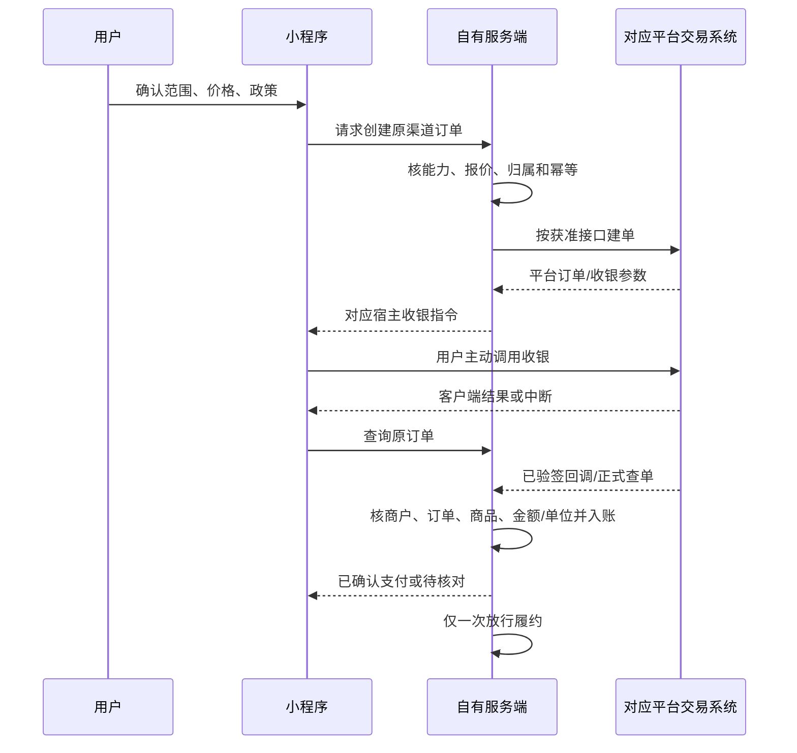

# 表格修复站：账号、订单、支付与权益

P07｜v3.0｜2026-10-27｜业务合同设计；平台开通、SDK和结算均未完成。完整政策见[交易主文档](../04-计费交易与运营.md)，来源和冲突见[官方核对](../资料/双小程序官方能力核对-2026-10-27.md)。

## 身份模型与使用范围

一个平台身份由provider、app_id和平台校验后的subject唯一确定，映射内部私有账户/租户。临时登录凭据送服务端按正确环境校验，客户端自报user_id、昵称或手机号不能获得权限。应用凭据只在服务端，不进入包、日志或公开链接。

支付宝和抖音可以独立注册、独立用，两端都不强制提供手机号/头像。未绑定时任务、规范、订单和结果各自隔离。P0必须阻止自动误合和越权；跨端绑定入口在双方证明、冲突及权益策略具备后开放，未具备时明确关闭，不影响单端闭环。

绑定需要当前账号再次确认、另一端独立认证、短期挑战及冲突检查；同名、同号码、转发二维码、可猜账号均不足以自动关联。历史订单仍保留原平台/app/商户，解绑不删账或改变退款责任。合并/解绑有审计与可理解的影响提示，不在解绑时静默转移私有资料。

## 订单边界

任务、报价、平台订单、支付、运行、结果版本、文件领取、退款分别标识。一次订单许可约定的处理范围及修订，不是无限调用额度。订单绑定资料集/模式/用途/预算/规范合同及政策版本；DISCOVER绑定发现规范过程，后续明确采用记录，不能先假定不存在的最终规范已被用户同意。

字段至少包括内部order_id、provider/app/merchant、平台order/transaction_id、sku/quote/contract_hash、计价单位/整数数量、结算事实、创建/到期、履约/退款状态。敏感流水用于内部对账，前端只展示必要安全摘要。

报价不使用前端传入金额。CNY现金按整数分存储；平台若使用虚拟计价单位，保存原单位/数量、商品及平台明确结算事实，不能写死与人民币的转换/费率。退款累计不超过该单可退实付/单位，具体平台换算依获准接口。

## 收银时序

客户端success只触发查询；timeout/cancel/进程退出不直接定失败或重复收款。平台回调验签与归属核对、事件去重、数据库事务和发件箱后才发执行任务。未知时查原订单，明确终态后才允许新报价/单，不让用户反复付款。

执行状态、内容验收、履约交付、支付和退款是独立轴。收到钱不代表内容合格；生成文件不代表已保存到手机；退款申请不代表到账。我的订单和任务页显示同一服务端状态及原因。

## 各平台适用条件

| 发布单元 | 必须确定 | 当前决定 |
| --- | --- | --- |
| 支付宝Android/iOS | 境内小程序主体、类目、商户/app绑定、具体收银/查单/退款接口、数字服务适用条件 | 未验证，不启用收费；国际Alipay+同名API不作国内证明 |
| 抖音Android | 商品服务类目、平台指定交易通道、商户/履约/售后、文件服务是否可售 | 按官方准入和实际开通实施，不用通用转账代替 |
| 抖音iOS | 对本SKU适用的虚拟支付/其他交易规则及正式能力 | 官方不同入口资料有冲突，待确认；对应收费开关关闭 |
| Web进阶P1 | 独立商品与支付合法路径、允许的账号/权益关联 | 不能用于把受限小程序用户引导出站付款 |

抖音交易文档将接入与类目/商户及履约相连，不能从有一个支付API推断本项目自动有售卖资格。[交易方案](https://developer.open-douyin.com/docs/resource/zh-CN/mini-app/open-capacity/solutions/general-solution/trade)

对抖音iOS，官方一个入口描述虚拟支付限制，另一个入口描述平台虚拟支付方式。当前未取得可消除冲突的适用解释，不能断言所有iOS都不可用或本商品已开通。向平台核对目标app/SKU/OS/交易方案，取得有效规则和开通证明后更新商品、计价、退款和界面。确认前不引导去Web、Android、二维码或另一个小程序付款。[限制页](https://developer.open-douyin.com/docs/resource/zh-CN/mini-app/operation/management/specification/ios-virtual-payment)；[虚拟支付说明页](https://partner.open-douyin.com/docs/resource/zh-CN/mini-app/operation/management/specification/ios-virtual-payment)。

## 权益、跨端与免费体验

未验证规则前，收费任务仅按原渠道权益领取，账号绑定不自动搬迁订单/折抵余额。用户主动导出的普通文件与平台服务权益是不同对象；私有模板的合法跨端使用也需实际绑定及规则允许，不拿模板可下载证明跨平台收费权益通用。

未开通收费的发布单元可以在平台允许范围展示合成演示或有成本上限的免费体验，明确范围/次数/交付，不先收资料后诱导外站付款。免费额度由服务端许可并计成本，不伪装支付成功或制造交易流水。

## 修订、取消与退款

拟定严格验收/尽力报告两种合同，购买前主动选择，不在结果差时替用户切换。DISCOVER包含规范设计、首次采用及原目的内采用前调整；首次可审阅工作区24小时、两轮用户合并修订，平台纠错不占轮次。两者是拟定服务政策，须适配平台商品履约和售后规则再上线，不是授权冻结24小时。

0候选、无法履约、严格合同到约定窗口仍未达到条件等按约定及平台路径退款。部分不可读/超限须先确认范围，不保留原全量承诺再交截断结果。取消/完成并发由服务端条件更新裁决；取消后已下载副本无法收回，但未来执行/签链按退款和合同撤销。

退款请求有独立幂等键，原渠道提交、查单和入账对齐。记录REQUESTED/PROCESSING/SUCCEEDED/FAILED/UNKNOWN及平台事实；“已申请”不用“已到账”。售后查看必要订单与摘要，内容读取另获用户授权；在线文件保存期不终止平台售后责任。

## 对账与异常

每日对账核支付/退款/履约及未知订单，异常进入待处理列表，保留原始事件摘要/验签结论，正文不进账务日志。至少覆盖重复回调、伪回调、错金额/单位/商品、跨app流水、先退后回调、付款后断网、订单过期和取消竞态。

一个平台故障不能自动改用另一平台收款。故障开关暂停相应新单，已有任务/订单仍可查和售后。未经验证的开关不能因客户端指定OS或伪造宿主参数被绕过，服务端也校验资格。

## 赛事AI付与P1开放API

普通消费者收银、抖音订单和支付宝赛事AI付认可分别留证。是否符合参赛收入/付费调用口径，要按赛事与AI付正式要求确认，不能把普通订单数量直接当作AI付计分数据。

Machine Pay/A402、SDK/MCP属于P1开放API适配，需真实异步任务/授权/验付/结算/退款契约，与小程序消费者收银凭证隔离。不在首版手机界面展示HTTP402、开发者密钥或要求用户手工签请求。
