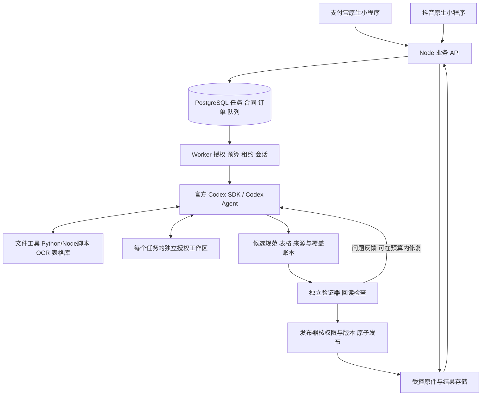

# 技术选型与架构决策

P07-DEV 2.0.0｜业务 v3.1｜设计 B 1.0.0｜设计完成，产品未实现。

## 执行主体

“Codex 内核”在本项目中指官方 Codex 运行时提供的任务理解、规划、工具调用、代码执行、文件操作与会话恢复能力。后端通过官方 `@openai/codex-sdk` 将它封装为资料成表 Agent；首版不分叉 Codex 源码，也不另写一个固定步骤的模型调用器来替代它。

Agent 可以先检查 Excel，再看图片，编写 Python 脚本读取 Word，发现金额单位不一致后回读原件，修复代码并重新成表。处理顺序、读取方法、临时数据结构和脚本由它依据资料决定。队列不为每一种文件格式和语义动作安排 PARSE/ANALYZE/EXTRACT 等刚性业务阶段。

## 技术栈与职责

| 层 | 决定 | 理由及边界 |
| --- | --- | --- |
| 客户端 | 支付宝、抖音各自原生小程序 + 共享 TypeScript 合同 | 直接完成文件输入、规范采用、问题审核和结果领取；Web P1 |
| 业务 API | Node.js 24 LTS / TypeScript / Fastify 5 目标栈 | 账号、授权、范围版本、预算、订单、人工决定、分页和下载 |
| 整理内核 | 官方 TypeScript Codex SDK + 锁定的 Codex 运行时 | 真正执行资料业务；SDK/CLI/model 精确版本在接入试验锁定 |
| Agent Worker | Node 服务、PostgreSQL 持久队列/outbox | 领取、创建/恢复会话、审计、投影、停止和提交；不替 Agent 决策如何清洗 |
| 工具包 | Python 3.13、可用 Node 工具、文档/表格/图像库 | Agent 可组合调用，也可写业务专用清洗代码；不是单独的固定引擎 |
| OCR | 可选 Agent 工具，供应商/本地实现待试验 | 必要时按授权页调用；数字 PDF 不强制 OCR |
| 独立验证 | 版本化确定性规则、来源/范围/文件回读与质量评测 | Agent 能看反馈，不能改验证器或冻结规范来造通过 |
| 持久化 | PostgreSQL 18 + 私有 ObjectStore 适配 | 原生部署；56 业务参考表 + 6 会话运行参考表 |
| 运行环境 | Windows 原生服务与受限身份/ACL | 不依赖 Docker、WSL、虚拟机、MXC、Redis |

这些主版本沿用已有工程目标，精确补丁、插件、Python wheel、锁文件及原生宿主工具链均需实际试验。本机只观察 Node 22.14.0、Python 3.13.1、pnpm 10.13.1 和桌面附带 Codex 预发行版，不能当作生产锁。当前没有安装应用依赖或启动服务。

## 控制权与必要业务门槛

Agent 拥有资料处理的决策权：读取、理解标准、发现对象粒度、清理转换、去重/拆合、证据保留、成表和自查。业务服务持有用户授权与商业状态：范围确认、规范采用、决定提交、额度预留、订单支付、取消删除、结果发布。

PROVIDED 在 API10 冻结用户明确确认的规范；DISCOVER 在完整范围分析后给出提案及预览，API20 采用后继续。Agent 不能以“更好处理”为由删字段/放宽规范。缺事实与冲突成为问题，不由它补造或擅自选真值。生成规范样例不成为源事实。

独立验证是发布门槛，不是第二套业务清洗流水线；它能拒绝、返回问题，不能修改事实。订单与售后只依赖服务端真实平台事实，Agent 没有资金、DB 或发布写权限。

## SDK、CLI 与 App Server 的选择

首选 SDK，适合 Node 后台自动化任务；`startThread`、`run`、`resumeThread` 为已核官方入口。SDK 的流式事件、取消、工作目录、结构化输出、权限和认证映射按锁定版本类型实证，不伪造参数。CLI `codex exec` 是 PoC/兼容适配的可选入口，使用 JSONL 事件与完成 schema，恢复必须指向准确会话 ID。

App Server 当前官方标为实验能力，首版不开启；未来需要更深自定义交互时另评估。不把 Agents SDK、MCP 或普通模型 API 当作必须重造的 Agent 核心。MCP 如使用，仅向 Codex 提供可信工具。

依据：[官方 SDK](https://learn.chatgpt.com/docs/codex-sdk)、[非交互执行](https://learn.chatgpt.com/docs/non-interactive-mode)、[App Server](https://learn.chatgpt.com/docs/app-server)。

## 架构决定记录

| ADR | 本版决定 | 验证要求 |
| --- | --- | --- |
| 013 | Codex Agent 接管完整资料整理业务，替代 v1 ADR005/007 的固定编排及模型无工具设定 | 真实工具事件、Agent 脚本、双模式标准集 |
| 014 | 官方 SDK 为首选，CLI 可做适配后备，App Server 默认关闭 | 锁版本，核权限/认证/中断/恢复实际行为 |
| 015 | 一次业务执行对应受控工作区与会话映射，修订新 thread | 跨工作区读写拒绝、旧会话/旧规范拒绝 |
| 016 | 仅保留授权、采用、人工决定、验收发布等业务门槛 | 非固定处理阶段，Agent 自由迭代且受预算约束 |
| 017 | Agent 生成候选文件，独立程序验证并发布 | 文件回读、证据/覆盖、原子发布与取消竞态 |

v1 的原生双端、模块化 API/Worker、DB 队列/outbox、不可变版本、受控下载、精确金额和默认关闭未核能力等决定继续适用。当前完整参考接口见[运行时合同](../../assets/development/v2.0.0/agent-runtime.contract.json)。
