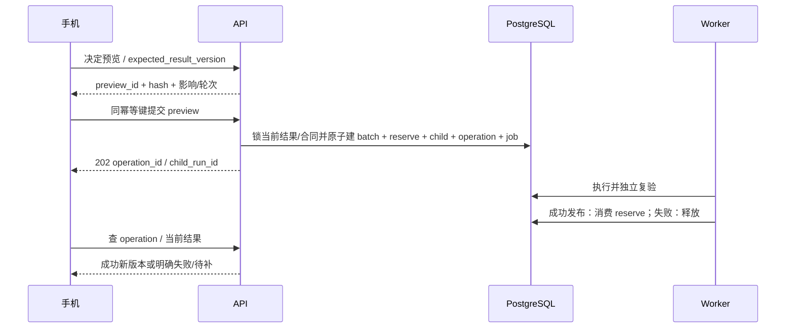

# 规范发现与人工决定

P07-DEV 2.0.0｜业务 v3.1｜W04/W06/W07 实施合同。

## Agent 是规范理解与整理执行主体

PROVIDED 的规范理解、DISCOVER 的主题/粒度/字段发现、自然语言修改影响分析及后续清洗，均由 Codex Agent 自主执行；本专题的规则/绑定/人工决定合同是必须满足的业务边界，不是传统阶段引擎的步骤表。用户表达修改后仍需可见差异与明确提交，不能让 Agent 默默采用。

DISCOVER 全范围提案完成时结束 turn，持久化文件与 thread 检查点，Run WAITING_SCHEMA，释放计算/worker。API20 采用后，宿主核源/目标/提案/绑定版本，以只读回执恢复原 thread；PROVIDED 绑定仍在 API10。每次修订 child Run/new workspace/new thread，输入父结果快照和已批准决定，不能恢复父成功 Run 来覆盖结果。

本专题禁止用户规则包含任意 Python/eval，是规范规则 DSL 的边界；Agent 可以自行编写并在受限工作区执行清洗代码，不能因此执行用户上传脚本或改变规范规则。

## 两种模式共用一个规范内核

PROVIDED 可从上传规范、本人私有规范版本或手动字段开始；必须澄清主表、每行对象、样例与规则。用户确认后建立 SchemaBinding，再正式抽取。DISCOVER 从全部已确认来源分析，输出 FULL_DRAFT，让用户审阅/调整/采用后绑定。付款或点击“开始”都不是采用尚不存在的完整规范。

PROVIDED 的明确确认随 API10 提交精确 draft_id/version 并与范围合同原子生成 binding；DISCOVER 先建无 binding 的范围合同/Run，再由 API20 采用全范围提案。两种模式共用绑定结构，但确认时点不同。

SchemaContent 至少含 schema_version、origin、purpose、row_kind、fields、identity_keys、rules、locale/timezone、rounding/export_policy。field_id 稳定，label 唯一，order 明确，type 为 TEXT/DECIMAL/INTEGER/BOOLEAN/DATE/DATETIME/ENUM，另有 required/nullable/unit/scale/description。字段重命名不换 field_id；删除/替换字段要有影响预览。

required + nullable 的适用含义必须明确；矛盾规则在采用前拒绝。0/false 不是空，空字符串不隐式等于 null；标识字段不得因“看着是数字”变成数值。ENUM 只有明确封闭规范才拒绝集合外值。

规则只允许版本化 AST：compare、and/or、required_if、精确 decimal 运算、批准的单位变换。禁 eval、SQL/Python 字符串、外链/任意函数。初版结构上限 depth≤8、nodes≤100、单字符串≤1000 码点为待试验工程候选；采用 RE2 类安全正则或首版不支持自定义正则，不能把不受限回溯交给用户。更改执行器需要 rule_engine_version 和回归。

## 无模板发现算法

1. 根据所有 SourceUnit 识别业务主题、实体和事件，列 row_kind 候选，优先确定“一行是什么”，不先堆字段。
2. 对同主题聚合字段同义、原始类型/单位/时间/重要信息，保留 observed_count / relevant_count 和 evidence_ids。分母是该字段适用的对象数，不是文件数。
3. 合并同义字段，但不同含义/单位/事件语境不强合。稀有关键字段单列，不能以频次低自动删除。
4. 给出推荐字段、可空/必填建议、identity_keys/规则依据和歧义；资料不能证明的约束明确标建议。
5. 做信息适合性检查，列重要未纳入项、未读/排除范围、其他主题。只有所有确认单元都有去向并完成分析才 FULL；FULL 不代表原不可读内容已理解。
6. 生成代表性记录预览并清楚标样本，不把预览数据写入规范本身；预览字段值仍需证据，不用生成器编例子混充用户数据。

合成报价标准用例：青禾 28.00、云杉 26.00、白石“待议”，保修 12 个月只在白石出现。结果必须保留价格 null/待议问题和保修可空字段，不能填平均价/默认保修，也不能为了推荐表简洁删保修。详见[合成验收规格](../../assets/examples/v3.1/报价资料成表-合成验收规格.json)。

## 草案、调整与采用

schema_proposals 保存 version/source_set/goal/input_hash/content/coverage/unmapped/preview/change_preview。PARTIAL_DRAFT 仅预检参考；FULL_DRAFT 才有可采用动作。API19 接 instruction 或受限 typed patch，两者互斥；自然语言由模型产生 patch 候选，服务端做类型/影响校验后返回新 proposal version，不直接更改已采用绑定。

变更影响必须量化受影响字段/候选/规则、移出信息、必填缺失、单位/对象粒度变化及需重算范围。删除关键字段、放宽规则或更换行粒度不能让旧结果“瞬间通过”；用户确认新目标后按新版本重新验收，并保留原报告。

API20 在事务内校 owner、run 当前 WAITING_SCHEMA、proposal FULL、expected_proposal_version/source_set_version/goal_version、无删除/过期；生成 immutable binding/hash，变更执行为 QUEUED + job。重复同键返回原 binding，旧版本 409。上一次 binding 的 SUPERSEDED 只是当前工作区投影；历史结果继续引用原绑定。

如果全范围建议仍有关键主表/含义歧义，需明确澄清；不能用“自动推荐”掩盖无法判断。用户选择的重要排除项记录在范围/规范版本和信息覆盖报告。

## 问题决定协议

允许的动作是 CHOOSE_EVIDENCE、USER_VALUE、KEEP_UNRESOLVED。每项决定包含 issue_id、record_id、field_id、action，以及证据 ID 或明确人工值/说明；服务端检查这些引用同属当前 result。KEEP_UNRESOLVED 保留原问题，不伪造解决。

预览 API24 用 expected_result_version + decisions + scope 得到 preview_id/hash/expiry、影响记录、例外、规则校验和费用/轮次说明。批量操作 scope 固定匹配谓词 + 确切目标 ID 集摘要；新版本或新候选不能悄悄纳入。预览必须列未匹配/不可操作项；不能用一项决定套所有“长得像”的字段。

人工值必须按字段 schema/type/unit 校验，保留 USER_PROVIDED、actor、timestamp，不冒充自动事实。跨记录批量选证据需对象关系合法；从别行取相同数字不能充本行依据。无法提供真值可 KEEP_UNRESOLVED，按问题状态/规范允许交付，不强迫用户填假值。

## 提交、预留和消费

一次成功发布修订只消费一轮；提交时先预留，确保剩余额度不能被并发超卖。平台漏识别/程序纠错不消耗用户轮次，但仍创建审计批次/子 Run/新结果。原始资料缺事实属于用户补值，不默认归平台错误；分类争议有客服记录与复核。

永久失败释放预留，UNKNOWN/执行中保留至确定结果；不能因客户端超时释放后第二次扣。FAILED Operation 终态保持，获准重试需 retry_of 新 Operation，沿用原 batch、重新预留但不能双消费。原结果仍可读，current result 只有发布成功才切换。

候选两轮/24 小时是商业政策候选，代码从 contract 的 policy_snapshot 读取；未验证 SKU 不开启收费承诺。取消、删除、退款撤权发生时同一事务裁决剩余修订和可下载权限，界面显示实际售后状态。
