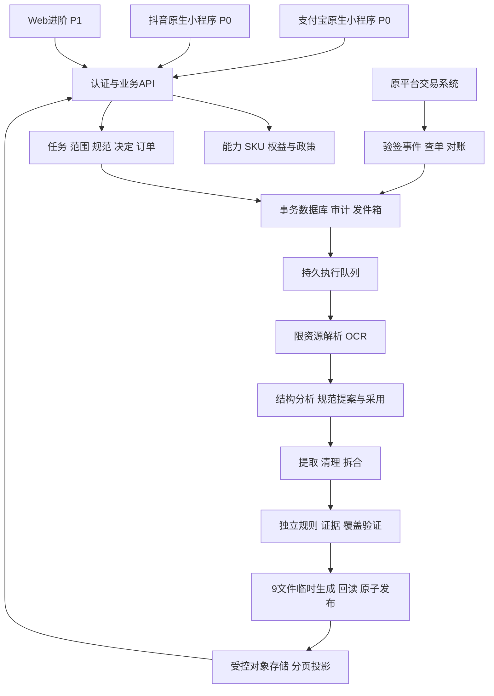

# 表格修复站：架构、数据与接口

P07｜v3.1｜2026-10-27｜架构与自有合同设计，尚未实现。平台SDK字段、主体/商户和最低版本必须正式验证，不以自有API名称冒充宿主能力。

## 系统边界

双端分别持有原生页面/登录/文件/权限/交易/生命周期适配，共享纯TypeScript领域类型和可测试状态映射，不在shared引用my/tt。API、worker、数据库/对象/队列分职责；实际依赖/版本在W01试验锁定，不创建未授权基础设施，不调本地Docker/WSL/虚拟机。

## 模块职责与写入权限

| 模块 | 权限与输入 | 产出/约束 |
| --- | --- | --- |
| 认证/租户 | 核平台临时凭据、会话 | owner由服务端决定，昵称/手机号不自动合并 |
| 能力/政策 | app/env/SKU/证据、已审核配置 | 允许动作和原因；不只相信客户端OS |
| 任务/规范 | 草稿、冻结范围、提案/采用 | 不可变SourceSet/Goal/SchemaBinding |
| 订单/权益 | quote与原平台事实 | 一次许可、原渠道退款和履约映射，不给模型凭据 |
| 原件存储/解析 | 本任务只读源与资源预算 | 稳定坐标、可读性及计量，不执行附件代码 |
| 规范发现/提取 | 允许资料与明确规范/目标 | 提案/候选/证据，模型无批准/外写/支付权 |
| 独立校验 | schema/候选/证据/范围账本 | 分项质量与问题，不能自改验收条件 |
| 修订协调 | 明确决定、expected_version | 原子决定批次/轮次预留/子Run，旧版仍可查看 |
| 产物/投影 | 指定结果版本 | 9文件同版、records/issues分页、短链 |
| 清理/运营 | 到期/删除标记、最小摘要 | 撤权/清理/审计/告警/对账，客服内容另授权 |

文件系统/对象键只由服务端生成，API不接受任意服务器路径或任意抓取URL。真实资料进入runtime或受控存储，不进公共assets。解析进程限资源但不宣称能安全运行任意恶意代码。

## 版本与事务边界

Task/Workspace是长期容器；Contract冻结一次处理范围，Run是一次执行，ResultVersion是不可变产出。SourceSet、Goal、SchemaProposal/Version/Binding、Policy分别有版本与hash。DISCOVER购买时冻结发现过程而非未知最终规范，采用后追加绑定。

详细字段及迁移见[数据字典](需求深化/02-数据字典与状态迁移.md)。v3.1新增NOT_EVALUATED等明确未评估状态；修订用子Run，不允许成功Run回RUNNING。等待规范不消耗计算时长，窗口由SKU合同决定，不从付款时间倒推人类审阅可用时长。

关键事务：支付事实去重+记账+履约发件箱；采用Binding+审计+恢复事件；决定批次+版本校验+轮次预留+子Run；产物校验+原子发布；删除标记+访问撤销+清理事件。事务提交后才执行外部副作用，发件箱可重放。原平台事件唯一键和请求摘要都需持久化，不以单机内存锁保证资金一致性。

外部支付/模型调用不放长数据库事务；先保存待处理动作，回执/查单更新。旧worker发布前核attempt租约、取消/删除标记、规范/结果父版，失败输出隔离清理。未知请求通过operation查询原动作，同键不同内容409。

## 平台适配器

自有authenticate/getCapabilities/selectSources/uploadSource/startCheckout/openOrExport/requestNotification各端实现。选择≠上传、缓存≠导出、客户端收银success≠服务端实付。原生参数仅通过正式适配器，不把用户文件中的指令发给支付服务。

平台能力四单元结构见[当前能力清单](../assets/platform/capabilities.v3.1.json)。域名/证书、隐私、类目/SKU、收银/退款/履约和宿主版本分别核验；DOCUMENTED不自动enabled。本轮文档复核未进行真实设备或交易。

## 数据投影与交付

手机默认20条、最大100条records/issues，3—5关键字段，其他按组展开；cursor绑定owner/result/filter/sort，证据图按需取，避免50列宽表或1000图全量渲染。前后台恢复只留最小resource/operation指针，不在普通本地日志存原文。

9文件：standard.xlsx/json为空规范，result.xlsx为未移出候选主表及_states/_issues/_sources/_excluded，accepted.csv仅通过行，result.json全候选及状态，issues.xlsx问题，provenance.jsonl字段依据，validation.json分项验收，manifest.json核其余8文件。自身hash外层接口返回，文件类型/数量/列序/编码/危险公式与空集都回读后发布。

Artifact=READY不等于设备已取用；FETCHED/CACHED/OPEN/EXPORT_REQUESTED/USER_CONFIRMED/PLATFORM_CONFIRMED按真实观察记录。导出失败重签重取，不建新计算单。签链默认300秒，权限内可续，到期/退款/删除/撤权先核；要求可撤销下载路径并记录已发短链的最坏失效窗口。

## API与错误合同

前缀/v1/p07，自有53项操作定义见[接口载荷专项](小程序/08-接口载荷与状态合同.md)与[结构目录](../assets/contracts/api-catalog.v3.1.json)。HTTP接口契约目前为设计草案，不声称已生成运行SDK或完整OpenAPI实现。

共同要求：服务端归属；写入Idempotency-Key；适用expected_version；时间UTC；decimal字符串；统一request_id/error_code/user_message/retryable/current_version/allowed_actions；机密/堆栈不返客户端。统一操作查询支持已落库但响应丢失。

错误至少401会话、403归属/能力、409版本/幂等/旧游标、410内容到期、413限制、422输入/规范/预算、429预检限频、503依赖。DISCOVER无模板不能报SCHEMA_REQUIRED。支付待核使用正常资源状态/PENDING或异步202，不把超时当失败；退款到账只按通道确认。

## 可运行性、预算与运维

原生部署与启动/停止、锁依赖、数据库迁移/备份恢复、密钥、队列与清理需要后续实际交付。并发/展开量/阶段超时/最大内存按[非功能要求](需求深化/04-非功能安全与运营需求.md)在试验环境锁定。累计计算含重试与修订，用户等待另计；供应商失败不能无限重跑。

监控按request/operation/task/run/stage/attempt关联，无正文；支付/退款未知进对账，删除/撤权恢复前重放tombstone。正式部署地域、OCR/模型供应商及保留条件是待决依赖，未证实不承诺零留存或上线时间。
