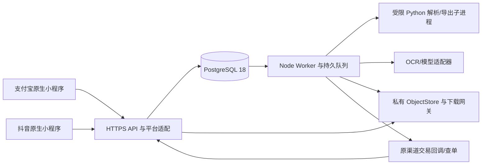

# 技术选型与架构决策

P07-DEV 1.0.0｜业务 v3.1｜设计 B 1.0.0｜状态：工程方案，未实现。

## 运行架构

Node API、Worker 是同一仓库的不同原生进程。领域模块共享，但 HTTP 进程不执行重解析、不等待模型完成，也不因手机退后台丢任务。PostgreSQL 是状态、授权事实、预算及任务投递的唯一事务真源；文件系统存不可变对象。Python 不持有商户密钥、客户端会话或数据库账户。

## 栈与版本决定

| 层 | 选择 | 锁定规则 |
| --- | --- | --- |
| 手机 | 支付宝/抖音原生视图、页面、组件、宿主适配器 | 两个原生工程；不以 web-view 承载 P0 主流程 |
| 共享逻辑 | 项目级 TypeScript；纯领域类型、校验、分页/恢复状态机 | 编译到宿主已验证的 JavaScript 语法；不把 Node API 打进手机 |
| 后端 | Node.js 24 LTS、Fastify 5、项目级 TypeScript | W01 锁精确 patch、编译目标及插件；维护 lockfile |
| 数据库 | PostgreSQL 18 | 原生安装/连接；业务事务 + durable jobs + outbox |
| 文件引擎 | Python 3.13、项目独立 venv | pypdf、python-docx、openpyxl + defusedxml、Pillow 等先做格式/安全试验再锁精确版本 |
| PDF 页图 | PdfRenderer 接口，原生 PDFium 类绑定为候选实现 | 许可证、Windows wheel、页图坐标/旋转/资源限制试验通过才启用 |
| OCR / 语义模型 | 服务端显式 ProviderAdapter | 供应商未选定；结构化输出、计量、超时、隐私及删除能力为准入条件 |
| 包管理 | 项目局部 pnpm；沿用可用 10 系列作为首次试验起点 | bootstrap 后 packageManager 固定精确版本；不全局升级 |
| 测试 | Node test runner、Fastify inject、Python unittest + 真 PostgreSQL | 支付和宿主还需对应真实环境；禁 Testcontainers |
| 对象存储 | Windows 私有目录适配器为本地默认；保留远端私有 ObjectStore 接缝 | 路径在 runtime；生产如换服务需兼容性与撤权试验 |
| 部署 | Windows 原生 API / Worker / scheduler 服务 | 不依赖 Docker、WSL、虚拟机或 Redis 服务 |

本机只观察到 Node 22.14.0、Python 3.13.1、pnpm 10.13.1；`psql` 不在 PATH。不表示 PostgreSQL 已安装，也不表示上述旧 patch 通过安全核验。本轮未安装/升级任何工具。目标 Node 24 是项目工程决定，实施时使用项目局部运行时，不能据本文声称环境已就绪。

Node 官方列 24 为 LTS；生产选 LTS，并在 bootstrap 锁支持中的 patch。[Node 发布计划](https://nodejs.org/en/about/previous-releases)。Fastify 5 的输入/输出使用完整 JSON Schema，插件必须和其支持矩阵匹配。[Fastify 5 迁移文档](https://fastify.dev/docs/latest/Guides/Migration-Guide-V5/)、[LTS 策略](https://fastify.dev/docs/latest/Reference/LTS/)。TypeScript 编译器留在项目并由锁文件控制。[项目级安装说明](https://www.typescriptlang.org/download/)。

## 模块与依赖方向

| 模块 | 写入职责 | 禁止依赖 |
| --- | --- | --- |
| identity / capability / privacy | 账户、真实平台身份、会话、告知、开关 | 不按昵称/手机号合并账户 |
| intake / preflight | 源角色、受控上传、计量、可读性、范围版本 | 不建付款事实、不悄悄缩范围 |
| contracts / schemas | 范围、预算、规范草案、不可变绑定 | 不修改已付合同、不用模板行补事实 |
| runs / workflow | 队列、阶段、租约、累计计算、检查点 | 不依赖客户端在线，不重开终态 Run |
| extraction / validation | 证据提取/拆合、规则/事实/覆盖独立检查 | 不授权支付，不自行批准用户决定 |
| decisions / artifacts | 预览、原子修订、九文件、受控取用 | 不覆盖旧结果，不把缓存回调等同交付 |
| commerce | quote、order、支付/退款、ledger、对账 | 不直接更改业务事实；不接收客户端付款断言 |
| support / deletion / operations | 限权售后、删除、告警、证据登记 | 不无限保存正文，不绕开审计 |

Controller 只解包、鉴权、校验、调用 application service。Application service 开启事务、锁行、调用 domain guard 和 repository。Domain 不认识 Fastify/my/tt/供应商 SDK；adapter 实现外部 I/O。所有写入口依赖相同 guard，不为客服脚本或回调另开绕路。

## 已决定的 ADR

| ADR | 决定 | 原因与代价 |
| --- | --- | --- |
| 001 | 原生双端 + 共享纯逻辑 | 优先保宿主文件、支付、生命周期真实性；两份视图需分别维护和测试 |
| 002 | API / Worker 分进程的模块化单体 | 单库事务清楚、原生部署简单；P0 不提前拆微服务 |
| 003 | PostgreSQL 队列与 outbox | 原子建任务/投递；需正确实现租约、清理、索引和死任务回收 |
| 004 | 无 Redis 硬依赖 | 减少 Windows 额外守护进程；短期缓存/限流使用 DB 原子计数和进程内非权威缓存 |
| 005 | Node 编排 / Python 数据处理 | 解析生态与交易权限分离；子进程协议和资源管控需专门实现 |
| 006 | 版本化不可变内容 | 修订生成子 Run / 新结果；存储增加但可审计和回滚读取 |
| 007 | 模型只提出结构化候选 | 防越权/编造；受限 schema、证据和独立验证增加工作量 |
| 008 | 私有对象 + 每次请求鉴权网关 | 删除/退款后可撤后续访问；网关带宽与权限查询需要预算 |
| 009 | 金额整数 + 精确单位，事实 decimal 字符串 | 避免浮点/单位误算；平台虚拟单位不能默认折人民币 |
| 010 | 不新增 P0 大屏依赖 | 手机完成普通任务；Web 复用相同领域合同并在 P1 独立鉴权 |
| 011 | 编译时/运行时双重能力开关 | 未获准能力默认关；维护四环境/SKU 的真实证据配置 |
| 012 | 参考 DDL/OpenAPI 先审后执行 | 让工程可评审；文档静态检查不能替代数据库/设备试验 |

PostgreSQL 的 `FOR UPDATE SKIP LOCKED` 适合多消费者领取队列，不适合普通一致性查询；本方案只在 job 领取使用。[SELECT 锁说明](https://www.postgresql.org/docs/18/sql-select.html)。将来吞吐不足时，可把 job 的发送适配器替换为外部队列，但支付、预算、幂等和发件箱仍需事务事实，不能由 broker 代替。

## 不确定性关闭方式

外部接入逐项登记在 [integration-register.json](../../assets/development/v1.0.0/integration-register.json)。外部未锁定时可用合成 fixture 开发，但环境必须标 SYNTHETIC/NOT_RUN。产品上的输入/领取/收费按钮由实际 capability 决定；不能用 mock 通过来开启生产。

内部 ADR 修改新增编号/版本并检查需求映射、数据迁移、回归和成本；改变宿主载体或 P0 范围属于需求变更，不能仅在技术文档中悄悄删减。
