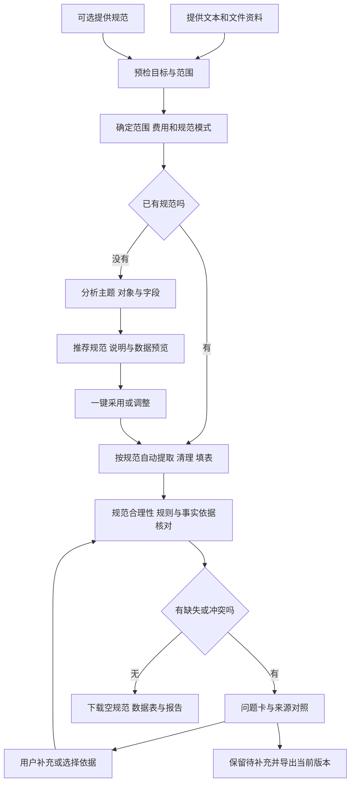

# 表格修复站：多源资料与规范表成表

P07｜v3.0业务示例｜2026-10-27。依据用户两次调整：可按用户给定规范整理，也可在没有规范时由系统分析资料、生成规范并整理。以下是拟建体验及合成示例，尚未实现软件。

## 1. 产品要交付什么

用户把散乱资料交给系统；已有标准表时可一并提供，没有时由系统分析主题/对象/字段，推荐结构和规则。规范明确后自动阅读提取、清理、合并互补信息、拆分多个对象，再按标准填表核对。

这里的“规范表”是任务目标和验收依据。它决定输出哪些列、什么顺序、每行是什么对象、字段如何填写；待整理资料提供事实。用户不需要先把输入整理成表，也不需要先逐列指定来源映射。

用户可以用现成的空Excel/CSV表、带示例的规范表，或在小程序字段编辑器定义目标字段。示例行帮助理解“怎么填”，不能当成“实际有哪些人/商品/记录”。系统不能从列名判断的必填、计量单位、行粒度等，仅以简短问题补确认。没有规范时进入系统分析生成模式，展示推荐规范及预览，用户可一键采用或微调，无需自己定义表头；未采用不能冒充已明确标准。详见[无模板专项](无模板分析与规范生成-2026-10-27.md)。

“完整”有三个层次：目标结构完整；资料中能确定的信息正确归位；缺失、冲突、未能读取的部分全部可见。规范要求的真实信息不存在时，结果可以是结构完整但待补充的表，不能靠编造变为验收通过。

## 2. 交互载体与页面

首版主载体为支付宝、抖音小程序，手机内完成资料提交、规范采用、自动整理、问题处理和实际领取。默认记录卡/问题列表，字段和来源逐级展开；Web进阶版P1提供大屏表格和来源并排。自有业务API支撑双端，开放Agent/SDK/Machine Pay为P1。实际页面以[移动端页面规格](../小程序/02-移动端页面与交互规格.md)为准。

新建任务页显示资料与规范两个区域，规范可提供或由系统生成：

| 区域 | 用户操作 | 系统呈现 |
| --- | --- | --- |
| 待整理资料 | 粘贴文本、经已验证入口选择多份资料、查看或移除资料 | 附件/文本清单、格式、读取状态、页或工作表范围、未支持原因 |
| 规范模式 | 选择我有规范或帮我生成；可上传空表/示例表，或采用系统建议 | 原模板或推荐结构、字段解释、来源依据、一行含义、规则建议与未纳入项 |
| 任务说明 | 例如“按报名编号合并，整理本次活动名单” | 目标摘要和关键确认卡；对话用于说明需求及处理歧义 |
| 开始整理 | 了解处理范围、用量与总价；无模板全范围分析后采用推荐方案 | 固定源清单/目标/预算，规范明确时绑定版本；普通字段不逐格确认 |

运行后手机进入结果概览，以记录卡、问题列表和字段详情呈现，按需查看来源和选列表格预览；顶部区分执行进度与规范验收。Web进阶P1才采用资料、表格和证据并排。用户能筛选问题、选择依据或补值，明确范围后提交复验，并实际领取文件。

进度展示“读取资料→提取字段→合并整理→按规范核对→生成结果”，区分排队、运行、需补确认、通过、失败。不能把模型正在生成的逐字文本当成已经验收的表格。

## 3. 一次完整操作

例如同一个“姓名”字段来自正文、表格或截图，系统自行处理来源差异；同一个报名编号在三份资料中出现，系统按确认的归并键汇总。若资料中有两个人同名，但没有可靠标识，系统提示疑似关联，不能凭姓名相似直接合为一人。

## 4. 混合资料示例

本例全部为虚构数据。规范列为“报名编号、姓名、单位、参加形式、饮食偏好”，一行一次报名；前四列必填，饮食偏好可空。参加形式只允许“线上/线下”，报名编号是归并键。

用户提交三份资料：

1. 粘贴文本：R-001林安，青禾工作室，线下，素食；R-002周宁，云杉设计，线上参加。
2. Word补充名单：R-002周宁，云杉设计，线下；R-003陈禾，线上。
3. 聊天截图：R-002周宁补充“素食”。

系统应自动归位后的主表为：

| 报名编号 | 姓名 | 单位 | 参加形式 | 饮食偏好 |
| --- | --- | --- | --- | --- |
| R-001 | 林安 | 青禾工作室 | 线下 | 素食 |
| R-002 | 周宁 | 云杉设计 |  | 素食 |
| R-003 | 陈禾 |  | 线上 |  |

界面另显示两项必须处理的问题，不把状态列强加到用户的目标表：

| 问题 | 用户看到什么 | 可做的决定 |
| --- | --- | --- |
| R-002参加形式冲突 | 文本写“线上参加”，Word写“线下”，分别可看原文 | 选择可靠来源、补充真实值，或保留待确认；上传先后不自动代表真伪 |
| R-003缺单位 | 本次资料均未提供单位 | 补充单位或保留缺失；系统不能从姓名推测 |

R-002的饮食偏好来自截图，与文本/Word中的其他字段合到同一行。R-003饮食偏好可空，因此不必为它阻断验收。当前共3条候选、1条通过、2条待补充；模板中的示例“R-999张例”不得进入结果。

手机点击R-002“素食”进入来源页查看截图区域；打开冲突问题卡可分别查看两个来源，返回保留原记录位置。Web进阶P1可在侧栏并排对照。若用户补值，标为人工补充；若用户选择已有来源，保留选择记录。用户可合并提交若干决定后复验，不需要重填整张表。

结构化设计素材：[规范示例](../../assets/templates/standard.example.v2.json)、[混合资料及预期结果](../../assets/examples/混合资料成表-设计示例.json)。它们是设计数据，未创建真实DOCX/图片或执行OCR，不能当作软件测试通过的证据。

## 5. 结果、能力与验收边界

用户最常用的交付是可编辑结果表、空白规范和问题报告。小程序突出三个领取按钮，通过行CSV和完整JSON等在更多文件中；实际导出路径按各端能力核验。来源和校验报告随包提供，普通用户无需理解内部协议。九文件合同见[技术规格](../03-架构数据与接口.md)。

“任意资料”是输入体验方向，实际逐格式发布能力。首版计划支持文本、TXT/Markdown、CSV/XLSX、DOCX、PDF、JPG/PNG与OCR；音视频和复杂多表模板后续扩展。未知、加密、损坏、超限和识别不清都应有明确状态，不默默少处理一份资料后显示全部完成。

验收分开核对：目标结构/列序；字段类型/必填/枚举/单位；跨资料对象关系；字段来源；缺失与冲突；本次资料覆盖。每个文件有读取状态并不能证明语义零遗漏，因此另外用人工标准答案衡量准确率和召回率。

当前阶段仅调整需求。正式执行前展示处理范围、费用和资料用途；不延续旧版单一订单表、1.9元或2分钟承诺。功能范围、费用/修订和测试要求分别以[功能规格](../02-功能需求与用户流程.md)、[交易规则](../04-计费交易与运营.md)、[验收计划](../05-验收测试与实施计划.md)为准。
