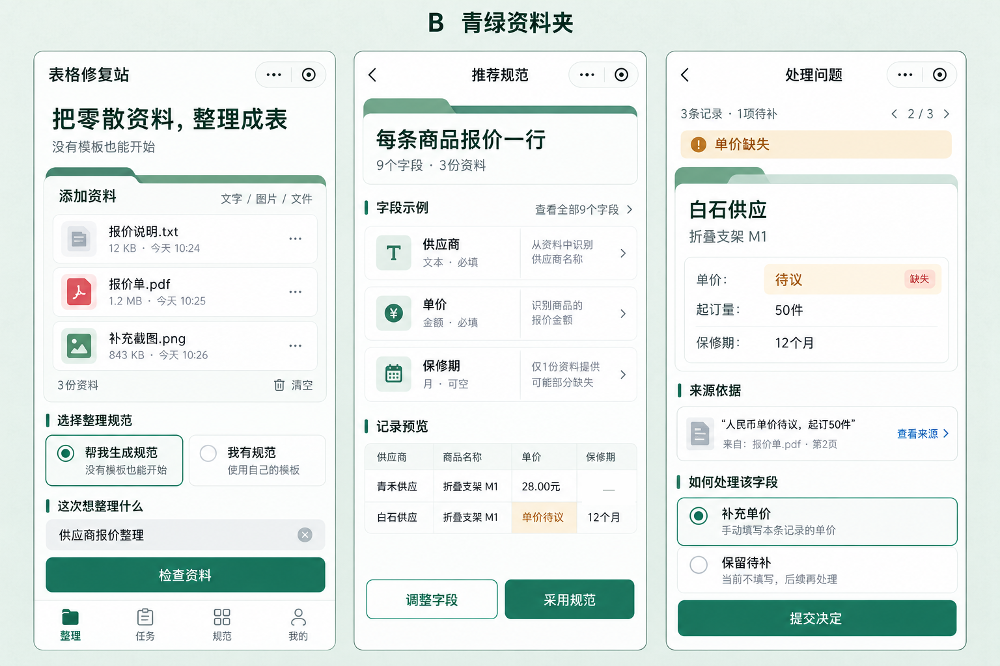

# 表格修复站：B青绿资料夹设计定型

设计标识P07-DS-B｜设计版本1.0.0｜定型日期2026-10-27｜对应业务需求v3.0。

**用户已明确选择方案B「青绿资料夹」。本目录为后续支付宝、抖音小程序的统一设计基线。** 原五方案评估中的A优先建议仅为选型前历史，不再是当前实施方向。Web进阶版后续沿用B体系扩展。

本轮完成设计系统、页面规则与参照留存，不表示已实现、真机验证或发布。32个组件和18页规则已定义；独立图像参照为MP01/MP06/MP10三页，其他15页尚无单独高保真成稿，不将规则说明算作已画完全部页面。

## 定型内容

产品形象是一个清楚、可信、亲近的资料整理工具。以“将材料收进有序资料夹”为识别特征：青绿主动作、白色阅读面、有限资料夹页签、短索引线和规整字段目录。视觉服务资料角色、规范采用、问题与来源，不用拟物装饰遮盖事实。

首页先收材料；规范可提供，也可由系统推荐；结果默认记录卡/问题列表，字段和来源按需展开。普通任务在手机完成，Web进阶P1提供大屏对照。数据缺失、规范通过、支付到账、文件实际导出分别表达。

## 文件入口与阅读顺序

| 文档/资产 | 用途 |
| --- | --- |
| [01 视觉规范与设计变量](01-视觉规范与设计变量.md) | 配色、字体、间距、资料夹形态、层次与尺寸 |
| [02 组件与交互状态](02-组件与交互状态.md) | 32组件、变体、状态、表单/问题/交付表达 |
| [03 18页面定型规格](03-18页面定型规格.md) | 页面顺序、主动作、必备状态、需求和组件关联 |
| [04 双平台适配与Web延展](04-双平台适配与Web延展.md) | 共用视觉、原生边界、单位/字体/安全区及Web P1 |
| [05 设计验收与开发交接](05-设计验收与开发交接.md) | 开发使用顺序、状态场景、视觉检查与缺陷分级 |
| [06 留存清单与变更记录](06-留存清单与变更记录.md) | 已选稿/原稿/提示词/裁片/哈希、已知差异和版本政策 |
| [当前设计指针](../../../assets/design/active.json) | 后续工具和实现首先读取的当前版本 |
| [设计变量JSON](../../../assets/design/b-jade-folders/v1.0.0/tokens.json) / [CSS参考](../../../assets/design/b-jade-folders/v1.0.0/tokens.css) | 机器可读颜色/尺寸与参考页面变量，非已实现宿主组件 |
| [B设计参照页](../../../assets/design/b-jade-folders/v1.0.0/reference.html) | 离线看整板/分页面/色板/组件与规则摘要 |
| [完整资产清单](../../../assets/design/b-jade-folders/v1.0.0/manifest.json) | 版本内文件路径、大小和SHA-256，验证留存未被覆盖 |

## 稳定的设计决定

| ID | 决定 | 实施含义 |
| --- | --- | --- |
| B-D01 | B为唯一当前视觉方向 | 支付宝/抖音用同一青绿体系，其他四稿只留历史比较 |
| B-D02 | 资料夹语义、干净阅读区 | 每页最多一个重点资料夹容器；普通列表不重复加装饰页签 |
| B-D03 | 文字、图形和色彩共同标状态 | 绿色选中不等于内容通过；待补/冲突/失败/未知有文字 |
| B-D04 | 主动作唯一且状态真实 | 颜色强弱表达操作层级；无必需动作时不强塞主按钮 |
| B-D05 | 系统中文字体、无额外大字体包 | 字号按角色定义，支持大字号；不从整板像素推导宿主字号 |
| B-D06 | 单价待议不补0，来源不转移 | 真实给定值才填写；预览可空字段用—，完整数据仍为null及状态 |
| B-D07 | 两规范模式同级 | 不用“先上传模板”的空状态阻断DISCOVER |
| B-D08 | 原生系统边界优先 | 胶囊/标题栏/键盘/权限/收银不从图片重画假控件 |
| B-D09 | 图稿留存，规则和tokens明确细节 | 原图含蓝链接/渐变及未展开输入的示意，实施按各专项差异表落地 |
| B-D10 | 设计版本独立于业务版本 | 本次不增加/削减42项功能；后续视觉变化另记设计版本 |

## 规范优先顺序

业务语义以[PRD](../../01-产品需求PRD.md)和[移动交互规格](../../小程序/02-移动端页面与交互规格.md)为准；具体颜色/尺寸以本设计tokens及本目录组件/页面规则为准；图稿用于视觉层次和风格参照。平台官方要求作用于对应原生区域，差异记入实现记录，不能借“平台风格”随意把全站改回蓝/紫。

三页图中的合成内容、时间、文件大小及来源坐标不是真实业务凭证。参考稿不作为整张位图进入产品，控件、文字、状态和证据应实际实现。实际平台能力、交易资格和文件交付仍按原需求逐项验证。

## 后续执行

开发前读当前指针、本文、对应页面和组件规则；按tokens实现，拿B分页面对照布局/密度/间距，补齐异常状态再真机。普通布局/文案修正按这些规则推进，不需要再次进行五方案选型。若后续需求改变视觉方向或冻结规则，创建新版本并记录原因/影响，保留1.0.0原稿和哈希，不覆盖旧留存。
